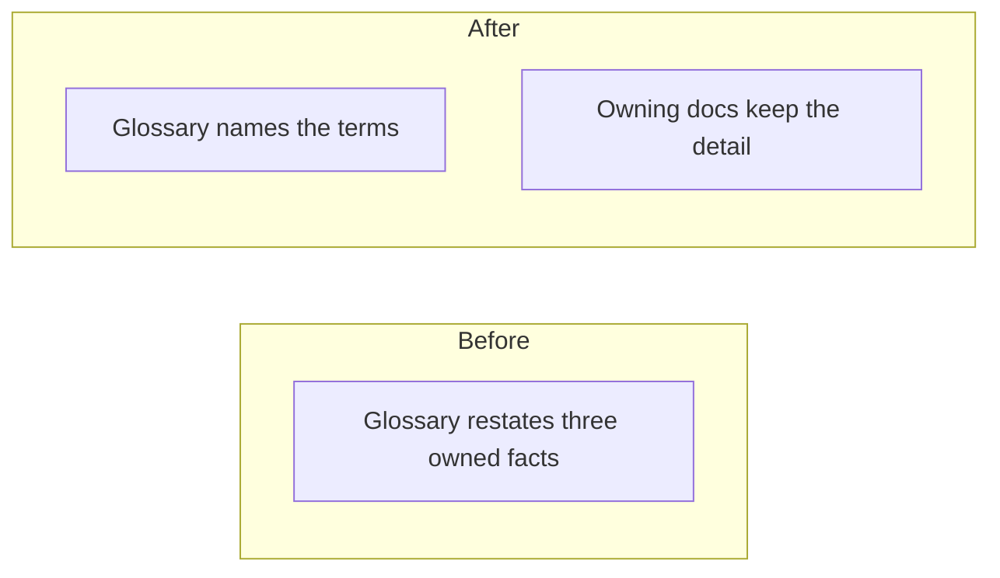

## Scenario

When a maintainer writes product copy or reviews a change, they open the terminology glossary, the project's normative list of agreed words — normative means that when another document or an interface string disagrees, the glossary wins. Three of its sections go beyond naming. One restates the replay-ordering algorithm, the rule for the order in which balance checks and transactions are applied when rebuilding an account's history, which the technical overview owns. One duplicates the distinction between Analysis (a versioned inference over saved evidence that produces findings with reasons and uncertainty) and income evidence (the result of the payments Analysis) and adds a sentence about where the result appears on the Outlook screen. One states the UI test policy together with a negative claim that a new route-name check would make false. No browser request or parser is involved; this is a documentation workflow the maintainer starts before the wording reaches a screen. The glossary exists so one name is agreed in one place while the owning documents keep the detail.

## Executive summary

The glossary is the single home for the project's agreed words. Three of its sections are not term definitions. One restates the replay-ordering algorithm owned by the technical overview, one duplicates the analysis-versus-income-evidence distinction from that same overview while adding a single sentence about where the result appears in the UI, and one states test policy together with a negative claim that becomes false the moment a route-name check is added. The code currently matches the documented ordering, so these are drift risks rather than contradictions. Reduce each passage to a naming fact plus a link.

## Recommended action

Reduce the replay section to naming facts plus a link to the technical overview. Delete the redundant distinction after moving the outlook sentence into the overview if that sentence is worth keeping. Reduce the test-policy section to the durable naming statement plus a `TESTING.md` link.

## Before and after

| Section | Before | After |
| --- | --- | --- |
| Replay ordering | Algorithm restated in the glossary | Naming facts and a link to the overview |
| Analysis versus income evidence | Distinction duplicated, with a UI-placement sentence added | Distinction left in the overview; outlook sentence moved there only if worth keeping |
| Test policy | Policy plus a negative claim that a route-name check would falsify | Durable naming statement and a `TESTING.md` link |

## Expected improvement

Each fact has one owner, so replay ordering, the analysis distinction, and test policy are each updated in one place. The negative claim also stops aging into a false statement. This is a maintenance-structure improvement; no benchmarks were run, so no speed, line-count, or bundle savings are claimed.

## Alternatives considered

- Leave as is — the three passages keep duplicating owned facts, and the negative claim becomes false as soon as a route-name check is added. Rejected.
- Move the full algorithm, distinction, and test policy into the glossary — that makes the glossary own content it was not meant to hold and reverses the documented ownership. Rejected.

## Downside of rejecting

Replay ordering, the analysis distinction, and test policy each keep two homes, so an update can be applied in one and missed in the other. The test-policy negative claim becomes wrong the moment a route-name check is added.

## Verification

Read the three passages side by side and confirm each fact resolves to exactly one owner. The code currently matches the documented ordering, so this is a drift risk rather than a contradiction. This is a proposed acceptance check, not a recorded result.

References: `docs/TERMS.md:22-26,109-115,130-132`; `TECHNICAL_OVERVIEW.md:316,512-515,622`; `backend/internal/domain/prepare.go:74-82,180-198`; `TESTING.md:79,87,98`.
