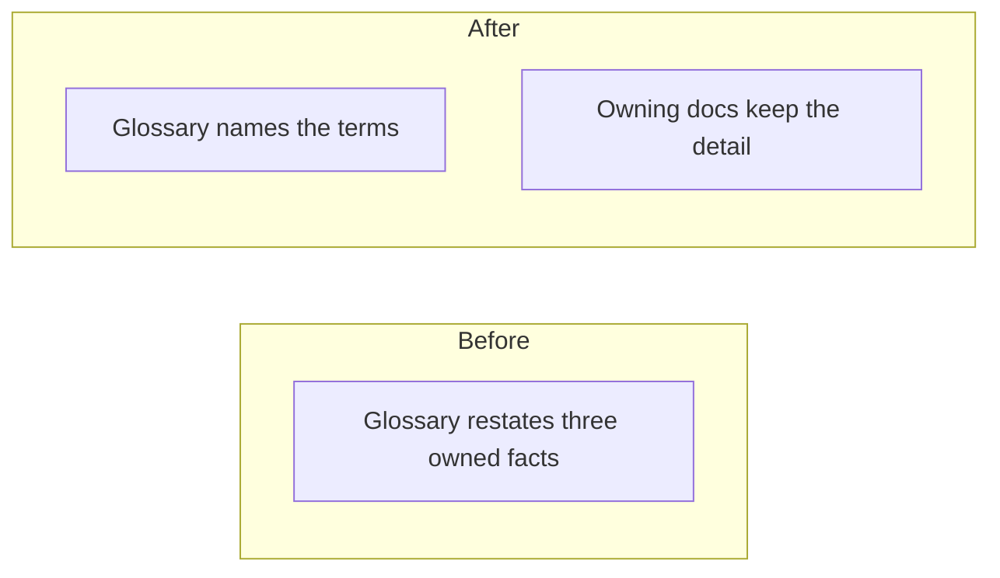

## Scenario

Maintainers write product copy and review changes against the terminology glossary, the file `docs/TERMS.md` in the repository's `docs/` directory. The glossary is the project's normative list of agreed words, where normative means that when another document or a string shown in the interface disagrees with the glossary, the glossary wins. Maintainers own the file and read it before wording reaches a screen. Three sections in the audited glossary go beyond naming a word.

The balance-check section at `docs/TERMS.md:22-26` restates the replay-ordering rule. Replay ordering is the rule for the order in which a balance observation, a recorded account balance that resets modeled history, and transactions, recorded money movements, are applied when rebuilding an account's history. The technical overview `TECHNICAL_OVERVIEW.md` at the repository root owns replay ordering in its "Historical Replay and Checkpoints" section, and the Go code in `backend/internal/domain/prepare.go:180-198` implements the sort: events are ordered by their instant, transactions run before an observation at the same instant, and an owner-authored observation runs last at that instant. The glossary section gives the rule a second home alongside the technical overview.

A second section at `docs/TERMS.md:109-115` restates the distinction between Evaluation, a named question asked of a projection with a stored configuration and a result, and income evidence, the computed result of recorded deposits. The section at `docs/TERMS.md:109-115` then adds a sentence about where the result appears on the Outlook screen. The technical overview owns the Outlook placement at `TECHNICAL_OVERVIEW.md:622`, which says Outlook renders only saved evaluation pins, using the same compact evaluation card components as the Evaluations page. The glossary's own Evaluation and Analysis sections already carry the definitions.

A third section at `docs/TERMS.md:130-132` states the UI test policy together with a negative claim: the browser route-name sweep was retired with the UI specs under the regression-first baseline, so no automated check exercises every interface route name. `TESTING.md:79,87,98` states the regression-first policy and the integration-suite commands. Adding a route-name check to catch a real regression would make the glossary's negative claim false the moment the check lands.

No browser request or parser is involved. The glossary workflow starts before the wording reaches a screen, and the glossary exists so one name is agreed in one place while the owning documents keep the detail.

## Executive summary

The glossary at `docs/TERMS.md` is the single home for the project's agreed words. Three of its sections are not term definitions. One restates the replay-ordering algorithm owned by `TECHNICAL_OVERVIEW.md` and implemented in `backend/internal/domain/prepare.go`; one duplicates the Analysis-versus-income-evidence distinction from that overview and `docs/TERMS.md`'s own sections while adding a single sentence about Outlook placement; one states test policy together with a negative claim that becomes false the moment a route-name check is added. The code currently matches the documented ordering, so these are drift risks rather than contradictions. Reduce each passage to a naming fact plus a link.

## Recommended action

Reduce the replay section to naming facts plus a link to the technical overview. Delete the redundant distinction after moving the Outlook sentence into the technical overview if that sentence is worth keeping. Reduce the test-policy section to the durable naming statement plus a `TESTING.md` link.

## Before and after

| Section | Before | After |
| --- | --- | --- |
| Replay ordering | Algorithm restated in the glossary | Naming facts and a link to the overview |
| Analysis versus income evidence | Distinction duplicated, with a UI-placement sentence added | Distinction left in the overview; outlook sentence moved there only if worth keeping |
| Test policy | Policy plus a negative claim that a route-name check would falsify | Durable naming statement and a `TESTING.md` link |

## Expected improvement

Each fact has one owner, so replay ordering, the analysis distinction, and test policy are each updated in one place. The negative claim also stops aging into a false statement. This is a maintenance-structure improvement; no benchmarks were run, so no speed, line-count, or bundle savings are claimed.

## Alternatives considered

- Leave as is — the three passages keep duplicating owned facts, and the negative claim becomes false as soon as a route-name check is added. Rejected.
- Move the full algorithm, distinction, and test policy into the glossary — that makes the glossary own content it was not meant to hold and reverses the documented ownership. Rejected.

## Downside of rejecting

Replay ordering, the analysis distinction, and test policy each keep two homes, so an update can be applied in one and missed in the other. The test-policy negative claim becomes wrong the moment a route-name check is added.

## Verification

Read the three passages side by side and confirm replay ordering resolves to `TECHNICAL_OVERVIEW.md`, the Analysis and Evaluation distinction resolves to the glossary's own sections, and the test policy resolves to `TESTING.md`. The code currently matches the documented ordering, so this is a drift risk rather than a contradiction. This is a proposed acceptance check, not a recorded result.

References: `docs/TERMS.md:22-26,109-115,130-132`; `TECHNICAL_OVERVIEW.md:316,512-515,622`; `backend/internal/domain/prepare.go:74-82,180-198`; `TESTING.md:79,87,98`.
