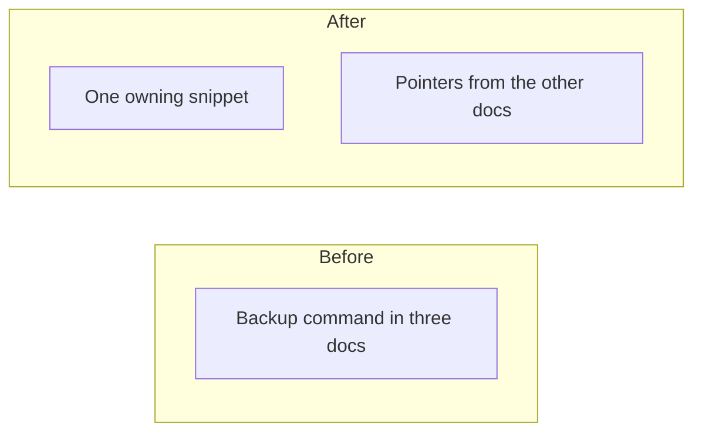

## Executive summary

The migration SOP owns the backup contract, but the shared-database guide and the deploy README each carry their own `sqlite3 .backup` and integrity-check snippets. Three copies of a safety-critical command drift easily, especially when one changes the file path or the verification step. Keep one owning snippet and point the other two docs at it.

## Recommended action

Keep the pointer at `docs/shared-database.md:91` and drop both code blocks, or turn the deploy README copy into a link to the SOP. No new command is introduced.

## Before and after

| | Backup command snippets |
| --- | --- |
| Before | `sqlite3 .backup` and the integrity check appear in the shared-database guide and the deploy README, while the SOP owns the contract |
| After | One owning snippet in the SOP, with pointers from both other docs |

## Expected improvement

A change to the file path or verification step is made in one place, so the safety-critical instructions cannot disagree with each other. This is a maintenance-structure improvement; no benchmarks were run, so no speed or size gain is claimed.

## Alternatives considered

- Leave as is — three copies keep drifting whenever the path or verification step changes. Rejected.
- Keep all three snippets and add a note to update them together — that relies on manual sync, which is the failure mode this finding flags. Rejected.

## Downside of rejecting

An operator following the guide or the README can back up to a stale path or skip the current verification step while the SOP states a different, correct contract.

## Verification

Search `.backup` across `docs/` and `deploy/` and confirm one owning snippet plus pointers. This is a proposed acceptance check, not a recorded result.

References: `docs/shared-database.md:89-118,99,110`; `deploy/README.md:67-77,72`; `deploy/MIGRATIONS.md:110,124-125`.
