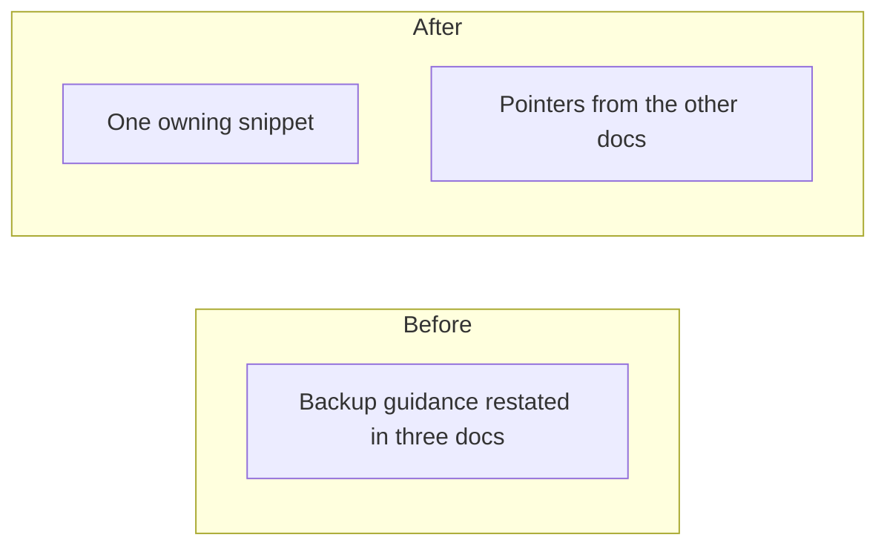

## Scenario

Before a schema upgrade, an operator follows the migration SOP to take a private backup of the application database. The SOP owns the exact commands: SQLite's backup API or the `sqlite3 .backup` command, which makes a consistent copy of a database that may still be written, and the integrity checks that verify the copy is structurally sound. The shared-database guide and the deploy README each restate the same backup and verification contract in prose while pointing at the SOP. This is an operator workflow, not a browser request: the operator starts it by stopping the API writers, and the verified backup plus its recorded hash come before any production change. No data format crosses a network boundary; the command works on a SQLite database file on the host and produces a backup set. The backup helper exists because copying a live database file directly can capture a half-written state.

## Executive summary

The migration SOP owns the backup contract, but the shared-database guide and the deploy README each restate that backup and verification contract in prose. Three homes for safety-critical guidance drift easily, especially when one changes the file path or the verification step, so an operator can follow a stale restatement while the SOP states a different, correct contract. Keep one owning statement and point the other two docs at it.

## Recommended action

Keep the contract in the migration SOP and reduce the passages in the shared-database guide and the deploy README to pointers. No new command is introduced.

## Before and after

| | Backup guidance |
| --- | --- |
| Before | The backup command and integrity check are owned by the SOP but restated in the shared-database guide and the deploy README |
| After | One owning contract in the SOP, with pointers from both guides |

## Expected improvement

A change to the file path or verification step is made in one place, so the safety-critical instructions cannot disagree with each other. This is a maintenance-structure improvement; no benchmarks were run, so no speed or size gain is claimed.

## Alternatives considered

- Leave as is — three copies keep drifting whenever the path or verification step changes. Rejected.
- Keep all three statements and add a note to update them together — that relies on manual sync, which is the failure mode this finding flags. Rejected.

## Downside of rejecting

An operator following the guide or the README can back up to a stale path or skip the current verification step while the SOP states a different, correct contract.

## Verification

Search `.backup` across `docs/` and `deploy/` and confirm one owning snippet plus pointers. This is a proposed acceptance check, not a recorded result.

References: `docs/shared-database.md:89-118,99,110`; `deploy/README.md:67-77,72`; `deploy/MIGRATIONS.md:110,124-125`.
