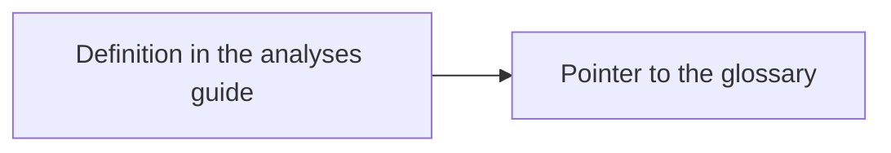

## Scenario

When a maintainer opens the Background Analysis guide to understand or change how the worker turns saved bank evidence into findings, the guide first tells the reader what Analysis and Evaluation mean. Those words are defined normatively in the glossary — the source that wins when another document disagrees — where Analysis is a versioned inference over saved evidence that produces findings with reasons and uncertainty, and Evaluation is a named question asked of a projection with a stored configuration and a result. The guide restates both definitions in glossary-like wording, but its phrase "findings and explanations" has already drifted from the glossary's "findings with reasons and uncertainty". No request or parser is involved; this is a documentation workflow the reader starts before changing analysis behavior. The glossary exists so a term has one definition that every guide can link to instead of copying it.

## Executive summary

The analyses guide defines Analysis and Evaluation in glossary-like wording, but the phrasing has already drifted from the glossary. The guide says "findings and explanations" where the glossary says "findings with reasons and uncertainty." Two homes for the same terms guarantee further drift. Replace the two definitions with a pointer to the glossary and keep only the doc-local scope statement.

## Recommended action

Replace the two definitions with a one-line pointer to the glossary's evaluation and analysis sections. Keep the doc-local scope statement and nothing else.

## Before and after

| | Analysis and Evaluation definitions |
| --- | --- |
| Before | Two glossary-like definitions in the analyses guide, with drifted wording |
| After | One-line pointer to the glossary, with only the doc-local scope statement left in the guide |

## Expected improvement

There is one definition to update, so the guide and glossary cannot drift apart again. This is a maintenance-structure improvement; no benchmarks were run, so no speed, line-count, or bundle savings are claimed.

## Alternatives considered

- Leave as is — the drift is already present and will grow with each glossary edit. Rejected.
- Correct the guide's wording in place — fixes this one phrase but keeps two homes, so the next glossary edit drifts again. Rejected.

## Downside of rejecting

Each glossary edit must be mirrored by hand, and any missed edit leaves two descriptions of the same terms carrying different meanings.

## Verification

After the edit, search each contested phrase and confirm it returns only the glossary. This is a proposed acceptance check, not a recorded result.

References: `docs/analyses.md:3-5`; `docs/TERMS.md:69-72,109-111`.
