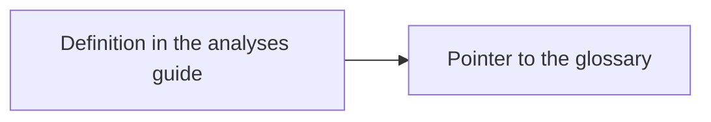

## Scenario

When a maintainer opens the Background Analysis guide `docs/analyses.md` to understand or change how the backend worker turns saved bank evidence into findings, the guide first tells the reader what Analysis and Evaluation mean (`docs/analyses.md:3-5`). The worker checks durable evidence revisions and computes findings without changing the saved financial model, which is why the guide needs those two words before it describes the lifecycle.

The glossary `docs/TERMS.md` in the repository's `docs/` directory is the normative list of agreed words: when another document disagrees with the glossary, the glossary wins. Its Analysis section at `docs/TERMS.md:68-71` defines Analysis as a versioned inference over saved evidence that produces findings with reasons and uncertainty, and its Evaluation section at `docs/TERMS.md:52-55` defines Evaluation as a named question asked of a projection with a stored configuration and a result. Maintainers own the glossary, and every guide is expected to link to it instead of copying a definition.

In the audited guide, both definitions were restated in glossary-like wording, and the restated phrase "findings and explanations" had already drifted from the glossary's "findings with reasons and uncertainty". Two homes for the same terms guarantee further drift: the next glossary edit must be mirrored by hand in `docs/analyses.md`, and a missed mirror leaves two descriptions of the same words carrying different meanings. No browser request or parser is involved; this is a documentation workflow the reader starts before changing analysis behavior. What stays in the guide after the rewrite is the single line that states which terms this guide uses.

## Executive summary

The Background Analysis guide `docs/analyses.md` defines Analysis and Evaluation in glossary-like wording, but the phrasing has already drifted from the glossary `docs/TERMS.md`. The guide says "findings and explanations" where the glossary says "findings with reasons and uncertainty". Two homes for the same terms guarantee further drift. Replace the two definitions with a pointer to the glossary's Evaluation and Analysis sections and keep only the doc-local line that states which terms the guide uses.

## Recommended action

Replace the two definitions with a one-line pointer to the glossary's evaluation and analysis sections. Keep the doc-local scope statement and nothing else.

## Before and after

| | Analysis and Evaluation definitions |
| --- | --- |
| Before | Two glossary-like definitions in the analyses guide, with drifted wording |
| After | One-line pointer to the glossary, with only the doc-local scope statement left in the guide |

## Expected improvement

There is one definition to update, so the guide and glossary cannot drift apart again. This is a maintenance-structure improvement; no benchmarks were run, so no speed, line-count, or bundle savings are claimed.

## Alternatives considered

- Leave as is — the drift is already present and will grow with each glossary edit. Rejected.
- Correct the guide's wording in place — fixes this one phrase but keeps two homes, so the next glossary edit drifts again. Rejected.

## Downside of rejecting

Each glossary edit must be mirrored by hand, and any missed edit leaves two descriptions of the same terms carrying different meanings.

## Verification

After the edit, search each contested phrase and confirm it returns only `docs/TERMS.md`, not `docs/analyses.md`. This is a proposed acceptance check, not a recorded result.

References: `docs/analyses.md:3-5`; `docs/TERMS.md:69-72,109-111`.
