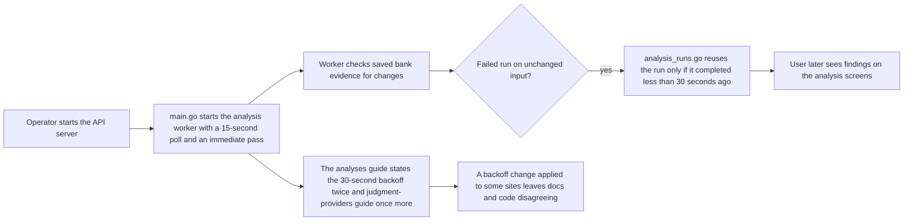
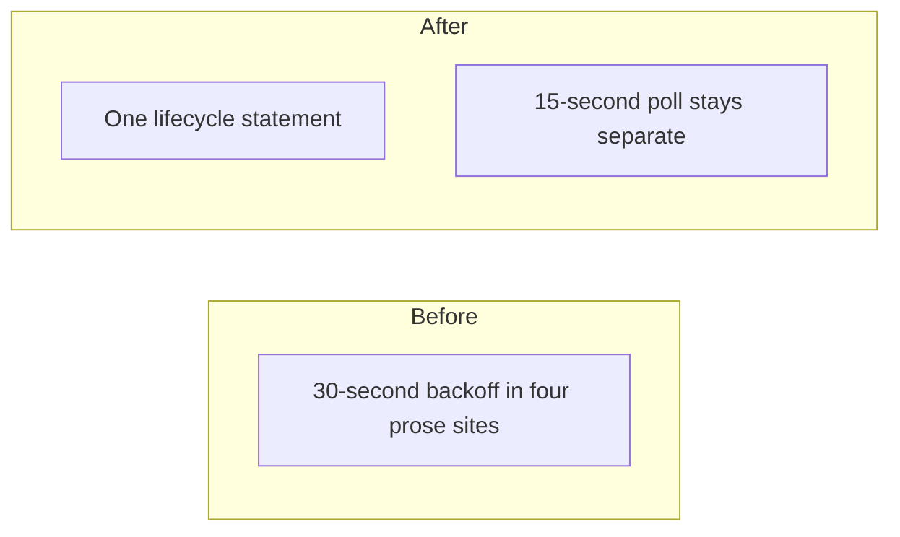

## Scenario

When the API server boots, `backend/cmd/server/main.go:91` starts the background analysis worker with a 15-second poll interval. The 15-second poll is the interval at which the worker checks saved bank evidence for changes, and the worker also makes an immediate pass at startup (`docs/analyses.md:8-11`). Saved bank evidence here means durable evidence revisions; balance-only updates and identical repeat feeds do not change that revision.

When the worker has already attempted a run, it waits at least 30 seconds before retrying a failure. The 30-second retry backoff is the minimum wait before starting a new run on unchanged input after a failed analysis run. It is implemented once in the analysis run store at `backend/internal/store/adapters/sqlite/analysis_runs.go:55`, which reuses a previous run whose input revision and version match, but for a failed run or a succeeded run with a problem only when that run completed less than 30 seconds ago. The browser does not start this work; the user sees the result later as findings on the analysis screens.

Two guides describe the same worker. The analyses guide `docs/analyses.md:18,194` states the backoff twice in its lifecycle prose, and the judgment-providers guide `docs/judgment-providers.md:56` restates it when describing deferred provider results. The 15-second poll is a distinct value — the interval for checking for new evidence — and must stay separate from the 30-second retry backoff. This is an internal workflow with no request crossing a browser boundary; the guides exist so a reader can see the lifecycle without reading the store code, which is why one guide should own the number and the other should link to it.

## Executive summary

The 30-second retry backoff is implemented once in `backend/internal/store/adapters/sqlite/analysis_runs.go`, but it is stated independently in `docs/judgment-providers.md` and twice in `docs/analyses.md`. Four prose sites for one number make a future change easy to half-apply. The 15-second poll that starts the worker in `backend/cmd/server/main.go` is a distinct value and must stay separate. Keep the full lifecycle statement in the analyses guide, reduce the judgment-providers mention to a link, and do not change either value.

## Recommended action

Keep the full lifecycle statement in the analyses guide and reduce the judgment-providers mention to a link. Do not change the value, and do not fold the 15-second poll into the same statement.

## Before and after

| Site | Before | After |
| --- | --- | --- |
| Analyses guide | Backoff stated twice in the lifecycle prose | One full lifecycle statement |
| Judgment-providers guide | Backoff stated independently | Link to the analyses lifecycle |
| 15-second poll | Distinct value | Unchanged and still distinct |

## Expected improvement

Changing the backoff means editing one statement, and the 15-second poll stays visibly separate so the two values are not conflated. This is a maintenance-structure improvement; no benchmarks were run, so no speed, line-count, or bundle savings are claimed.

## Alternatives considered

- Leave as is — four sites make a half-applied change likely. Rejected.
- Change the backoff value as part of the edit — this finding is about ownership, not tuning, and mixing the two would obscure the reason for the change. Rejected.

## Downside of rejecting

A future backoff change applied to only some sites leaves the docs disagreeing with each other and with the implementation, while readers cannot tell which statement is current.

## Verification

Search `30 second` across `docs/` and confirm one owning section, and confirm the 15-second poll remains distinct. This is a proposed acceptance check, not a recorded result.

References: `backend/internal/store/adapters/sqlite/analysis_runs.go:55`; `docs/judgment-providers.md:56`; `docs/analyses.md:19,194`; `backend/cmd/server/main.go:91`.
