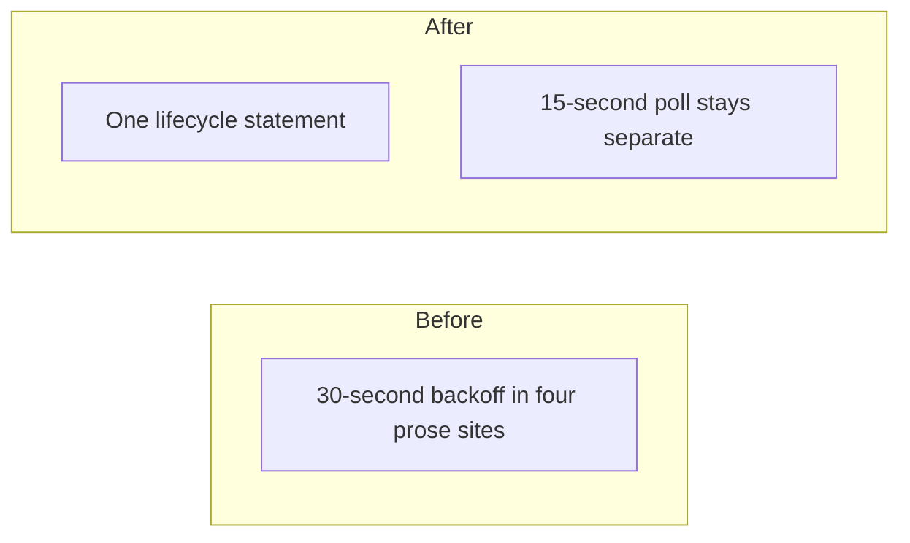

## Scenario

When the API server boots, it starts the background analysis worker, which checks saved bank evidence for changes every 15 seconds and, for a run it has already attempted, waits at least 30 seconds before retrying a failure. The worker starts this work at boot, not the browser, and the user sees the result later as findings on the analysis screens. The 30-second retry backoff — the minimum wait before trying a failed analysis run again — is implemented once in the analysis run store, but the analyses guide states it twice in its lifecycle prose and the judgment-providers guide restates it, with the 15-second poll, the separate interval for checking for new evidence, as a different value. This is an internal workflow with no request crossing a browser boundary; the guides exist so a reader can see the lifecycle without reading the store code, which is why one of them should own the number and the other should link.

## Executive summary

The 30-second retry backoff is implemented once, but it is stated independently in the judgment-providers guide and twice in the analyses guide. Four prose sites for one number make a future change easy to half-apply. The 15-second poll is a distinct value and must stay separate. Keep the full lifecycle statement in the analyses guide, reduce the judgment-providers mention to a link, and do not change either value.

## Recommended action

Keep the full lifecycle statement in the analyses guide and reduce the judgment-providers mention to a link. Do not change the value, and do not fold the 15-second poll into the same statement.

## Before and after

| Site | Before | After |
| --- | --- | --- |
| Analyses guide | Backoff stated twice in the lifecycle prose | One full lifecycle statement |
| Judgment-providers guide | Backoff stated independently | Link to the analyses lifecycle |
| 15-second poll | Distinct value | Unchanged and still distinct |

## Expected improvement

Changing the backoff means editing one statement, and the 15-second poll stays visibly separate so the two values are not conflated. This is a maintenance-structure improvement; no benchmarks were run, so no speed, line-count, or bundle savings are claimed.

## Alternatives considered

- Leave as is — four sites make a half-applied change likely. Rejected.
- Change the backoff value as part of the edit — this finding is about ownership, not tuning, and mixing the two would obscure the reason for the change. Rejected.

## Downside of rejecting

A future backoff change applied to only some sites leaves the docs disagreeing with each other and with the implementation, while readers cannot tell which statement is current.

## Verification

Search `30 second` across `docs/` and confirm one owning section, and confirm the 15-second poll remains distinct. This is a proposed acceptance check, not a recorded result.

References: `backend/internal/store/adapters/sqlite/analysis_runs.go:55`; `docs/judgment-providers.md:56`; `docs/analyses.md:19,194`; `backend/cmd/server/main.go:91`.
