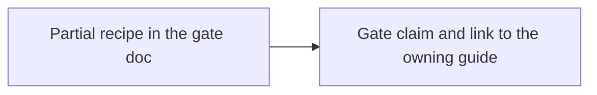

## Executive summary

The release-gates doc partially restates Deployment Guide recipes. Its image-validation line names two of the three commands in the images guide and omits the code-gate test, and its failed-release paragraph repeats a dispatch caveat that is stated more completely in the Northflank guide while also linking to it. A partial copy is worse than either a full recipe or a pointer. Keep the gate-level claims and point to the owning guides for the recipes.

## Recommended action

Keep the gate-level claim and point to the images guide for the recipe. Reduce the failed-release paragraph to the release requirements plus one link to the Northflank release-window section. No new recipe text is created.

## Before and after

| Passage | Before | After |
| --- | --- | --- |
| Image validation | Two of three commands restated; code-gate test omitted | Gate-level claim plus a link to the images guide |
| Failed release | Requirements plus a repeated dispatch caveat and a link | Requirements plus one link to the Northflank release window |

## Expected improvement

Commands and caveats live in their owning guides, so a recipe is updated once and the gate doc cannot carry a stale partial copy. This is a maintenance-structure improvement; no benchmarks were run, so no speed, line-count, or bundle savings are claimed.

## Alternatives considered

- Leave as is — the partial copy keeps drifting from the full recipe. Rejected.
- Copy all three commands into the gate doc — this adds a second full recipe and recreates the same drift risk. Rejected.

## Downside of rejecting

The gate doc keeps naming only two of the three validation commands, so a reader can treat the partial list as complete and skip the code-gate test.

## Verification

Search for the image test and actionlint commands and confirm the full recipe appears in its owner with a link from the gate doc. This is a proposed acceptance check, not a recorded result.

References: `docs/release-gates.md:70-72,86-93`; `deploy/images.md:35-38`; `deploy/northflank/README.md:100-105`.
