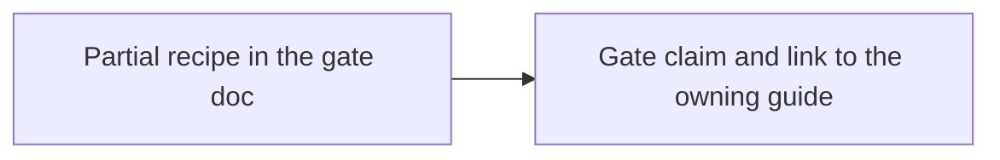

## Scenario

When a release is ready, an operator opens the release-gates document to confirm each gate and carry out the release steps: validate the deployment images, then request the Northflank release and record its run ID, migration backup hash and readiness result. The operator starts this work after the Tests workflow is green, and the published images plus the live API are the visible result. The exact validation commands are a recipe owned by the images guide, and the failed-release retry and dispatch caveat — the fact that a GitHub manual dispatch requests the current main commit, so a specific failed commit has to be released from Northflank with explicit parameters — are owned by the Northflank guide. The release-gates document keeps the gate-level claims and points at those guides. No browser request or data format crosses a boundary here; the guides exist to hold detailed commands that the gate document would otherwise carry as a partial copy.

## Executive summary

The release-gates document keeps gate-level claims but partially carries the deployment recipes. Its image-validation line points at the images guide without giving the full recipe, which includes the code-gate test, and its failed-release paragraph names the dispatch caveat while linking to the Northflank guide where that caveat is explained in full. A partial copy is worse than either a full recipe or a pointer. Keep the gate-level claims and point to the owning guides for the recipes.

## Recommended action

Keep the gate-level claim and point to the images guide for the full validation recipe. Reduce the failed-release paragraph to the release requirements plus one link to the Northflank release-window section. No new recipe text is created.

## Before and after

| Passage | Before | After |
| --- | --- | --- |
| Image validation | Partial recipe in the gate doc, with the code-gate test omitted | Gate-level claim plus a link to the full images guide recipe |
| Failed release | Requirements plus a named dispatch caveat and a link | Requirements plus one link to the Northflank release window |

## Expected improvement

Commands and caveats live in their owning guides, so a recipe is updated once and the gate doc cannot carry a stale partial copy. This is a maintenance-structure improvement; no benchmarks were run, so no speed, line-count, or bundle savings are claimed.

## Alternatives considered

- Leave as is — the partial copy keeps drifting from the full recipe. Rejected.
- Copy all three commands into the gate doc — this adds a second full recipe and recreates the same drift risk. Rejected.

## Downside of rejecting

The gate doc keeps naming only some of the validation commands, so a reader can treat the partial list as complete and skip the code-gate test.

## Verification

Search for the image test and actionlint commands and confirm the full recipe appears in its owner with a link from the gate doc. This is a proposed acceptance check, not a recorded result.

References: `docs/release-gates.md:70-72,86-93`; `deploy/images.md:35-38`; `deploy/northflank/README.md:100-105`.
