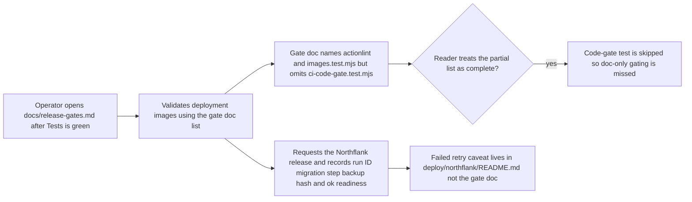
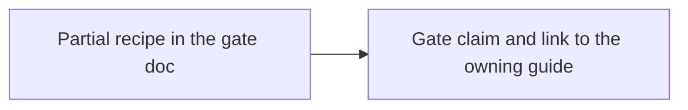

## Scenario

When a release is ready, an operator opens the release-gates document `docs/release-gates.md` to confirm each gate and carry out the release steps: validate the deployment images, then request the Northflank release and record its workflow run ID, successful migration step, backup hash, and `ok` readiness response (`docs/release-gates.md:82-88`). The operator starts this work after the Tests workflow is green; the published images and the live API are the visible result. The deployment images are the container images built after Tests, of which Northflank deploys the pinned backend-northflank and Better Auth images and Vercel deploys the frontend (`deploy/images.md:31-33`).

The exact image-validation commands are a recipe owned by the images guide `deploy/images.md:35-38`: `actionlint .github/workflows/images.yml`, `node --test deploy/images.test.mjs`, and the code-gate test `node --test scripts/ci-code-gate.test.mjs`. The code-gate test decides whether a change is documentation-only and therefore which gates run. The release-gates document at `docs/release-gates.md:70-72` names only the first two commands, so a reader can treat the partial list as complete and skip the code-gate test.

The failed-release retry procedure and the dispatch caveat are owned by the Northflank guide `deploy/northflank/README.md:100-105`. The dispatch caveat is that a GitHub manual dispatch of the release workflow requests the current `main` commit and its published images, so dispatching releases the failed target only while `main` still points at that commit. To release the failed target exactly after `main` has moved, the operator runs the workflow from the Northflank UI or API with `RELEASE_SHA`, `API_IMAGE`, `IDENTITY_IMAGE`, `IDENTITY_SERVICE_ID`, and `IDENTITY_DATABASE_ADDON_ID` overridden to that target's values. The release-gates paragraph names the caveat while linking to the guide that explains it in full.

No browser request or data format crosses a boundary here. The guides exist to hold detailed commands that the gate document would otherwise carry as a partial copy, and operators read the gate document first to decide which recipe they need.

## Executive summary

The release-gates document `docs/release-gates.md` keeps gate-level claims but partially carries the deployment recipes. Its image-validation line points at `deploy/images.md` without giving the full recipe, which includes the code-gate test, and its failed-release paragraph names the dispatch caveat while linking to `deploy/northflank/README.md`, where that caveat is explained in full. A partial copy is worse than either a full recipe or a pointer. Keep the gate-level claims and point to the owning guides for the recipes.

## Recommended action

Keep the gate-level claim and point to the images guide for the full validation recipe. Reduce the failed-release paragraph to the release requirements plus one link to the Northflank release-window section. No new recipe text is created.

## Before and after

| Passage | Before | After |
| --- | --- | --- |
| Image validation | Partial recipe in the gate doc, with the code-gate test omitted | Gate-level claim plus a link to the full images guide recipe |
| Failed release | Requirements plus a named dispatch caveat and a link | Requirements plus one link to the Northflank release window |

## Expected improvement

Commands and caveats live in their owning guides, so a recipe is updated once and the gate doc cannot carry a stale partial copy. This is a maintenance-structure improvement; no benchmarks were run, so no speed, line-count, or bundle savings are claimed.

## Alternatives considered

- Leave as is — the partial copy keeps drifting from the full recipe. Rejected.
- Copy all three commands into the gate doc — this adds a second full recipe and recreates the same drift risk. Rejected.

## Downside of rejecting

The gate doc keeps naming only some of the validation commands, so a reader can treat the partial list as complete and skip the code-gate test.

## Verification

Search for the image test and actionlint commands and confirm the full recipe appears in `deploy/images.md` with a link from `docs/release-gates.md`. This is a proposed acceptance check, not a recorded result.

References: `docs/release-gates.md:70-72,86-93`; `deploy/images.md:35-38`; `deploy/northflank/README.md:100-105`.
