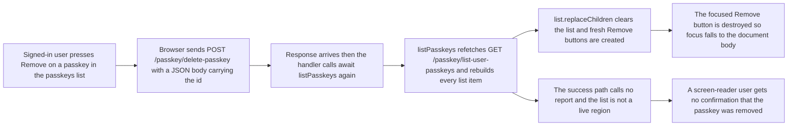
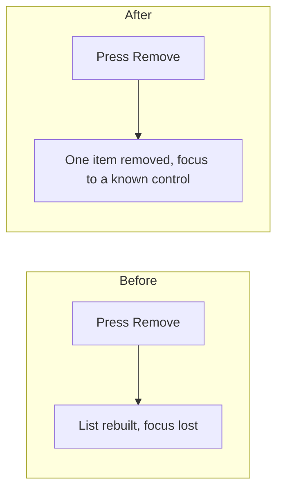

## Scenario

On the Account page of the auth service, the page at `/account` titled "Passkeys", a signed-in user presses Remove on one passkey in the list at `<ul id="passkeys">`. The page markup is assembled by `page(path, query, message, nonce)` in `auth/better-auth/src/pages.ts:47`, and the list is filled at runtime by `listPasskeys()` in `auth/better-auth/src/client.ts:34-64`. `listPasskeys()` fetches `GET /passkey/list-user-passkeys` and receives a JSON array of passkeys, each carrying an `id` and an optional `name`, then creates one `<li>` per passkey with a label and a Remove button.

The Remove button's click handler sends the request `POST /passkey/delete-passkey` with a JSON body carrying that passkey's `id` (`auth/better-auth/src/client.ts:54-57`). The browser makes the request after the click, and the response arrives just before the updated list appears. When the request succeeds, the handler calls `await listPasskeys()` again (`auth/better-auth/src/client.ts:59`) rather than updating one row. `listPasskeys()` refetches the whole list and rebuilds every list item: `list.replaceChildren()` at `client.ts:43` clears `<ul id="passkeys">`, and the loop creates fresh `<li>` elements and fresh Remove buttons.

`listPasskeys()` exists as the simplest way to make the display match the server after a change, but it destroys the Remove button that had keyboard focus, so focus falls to the document body. The successful delete path calls no `report()`; `report(message, tone)` at `client.ts:8-11` is the helper that writes text into the shared feedback paragraph, and the failure path calls it while the success path does not. The passkeys list is not a live region, an element whose text changes assistive technology announces, so a screen-reader user gets no confirmation that the passkey was removed.

## Executive summary

Removing a passkey calls `listPasskeys()` in `auth/better-auth/src/client.ts`, which clears and rebuilds every item in the passkeys list on the Account page. The focused Remove button is destroyed, so focus falls back to the document body. No success feedback is written to the feedback paragraph and the list has no live region, an element whose text changes assistive technology announces, so a screen-reader user gets no confirmation and a keyboard user must tab from the top again. Remove only the affected item, move focus to a known control, and report success.

## Recommended action

Remove only the affected list item and move focus to the next Remove button or the add-passkey control, then report success. If rebuilding the whole list stays, add a polite live region to the list and set focus explicitly after the rebuild.

## Before and after

| | Passkey removal |
| --- | --- |
| Before | Every list item is rebuilt, focus drops to the document body, and no success announcement is made |
| After | Only the removed item goes, focus lands on the next Remove button or the add-passkey control, and success is reported |

## Expected improvement

Keyboard and screen-reader users get a predictable landing place for focus and a confirmation that the passkey was removed. This is a structural accessibility improvement; no benchmarks were run, so no speed, line-count, or bundle savings are claimed.

## Alternatives considered

- Leave as is — focus loss and silence remain on every removal. Rejected.
- Keep the rebuild and only add a live region — success is announced but focus is still dropped, so the keyboard user starts over. Rejected as a weaker fix; usable only if item-level removal cannot be done.

## Downside of rejecting

Every removal sends keyboard focus to the document body and leaves screen-reader users without confirmation, so they must re-scan the passkey list to learn what happened.

## Verification

Walk the journey with a keyboard: tab to Remove, press Enter, confirm focus lands on a known control and the removal is announced. Keep `auth.test.ts` green. No screen-reader session was run for this audit, so the announcement failure is reasoned from markup rather than observed. This is a proposed acceptance check, not a recorded result.

References: `auth/better-auth/src/client.ts:42-43,53-60`; `auth/better-auth/src/pages.ts:47`.
