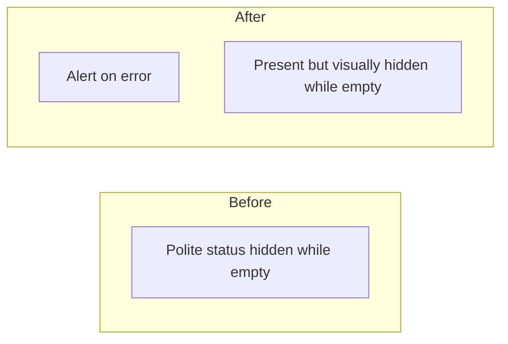

## Executive summary

The auth feedback region keeps `role="status"` and `aria-live="polite"` even when `report()` sets an error, so client-side passkey errors are not announced assertively. Its `:empty { display: none }` rule also removes the live region until text is injected, which screen readers often miss. Error versus success is carried only by token colors, while the canonical `FieldError` uses `role="alert"` (the assertive announcement role). Switch the region by tone, keep it present while empty, and add a non-color state cue.

## Recommended action

Switch the region to `role="alert"` when the tone is an error, keep it present but visually hidden while empty, and change only its text. Add a text or icon marker if color is the sole state cue.

## Before and after

| | Auth feedback region |
| --- | --- |
| Before | Always a polite status, hidden while empty, with error shown only by color |
| After | An assertive alert on error, present but visually hidden while empty, with a text or icon cue alongside color |

## Expected improvement

Failed sign-ins and failed passkey actions are announced assertively, and the region exists before text arrives so announcements are not missed. This is a structural accessibility improvement; no benchmarks were run, so no speed, line-count, or bundle savings are claimed.

## Alternatives considered

- Leave as is — errors stay polite and the region may be absent until it is too late to announce. Rejected.
- Only remove the `:empty` hiding rule — the region then exists but still announces errors politely and color remains the only state cue. Rejected as incomplete.

## Downside of rejecting

A client-side passkey error can be missed entirely, and success versus error stays distinguishable only by color.

## Verification

With a screen reader, confirm a failed sign-in and a failed passkey action both announce assertively. No test depends on the current strings, so wording can change freely. This is a proposed acceptance check; no screen-reader session was recorded for this audit.

References: `auth/better-auth/src/pages.ts:44`; `auth/better-auth/src/client.ts:8-11`; `auth/better-auth/src/auth.css:23-31`.
