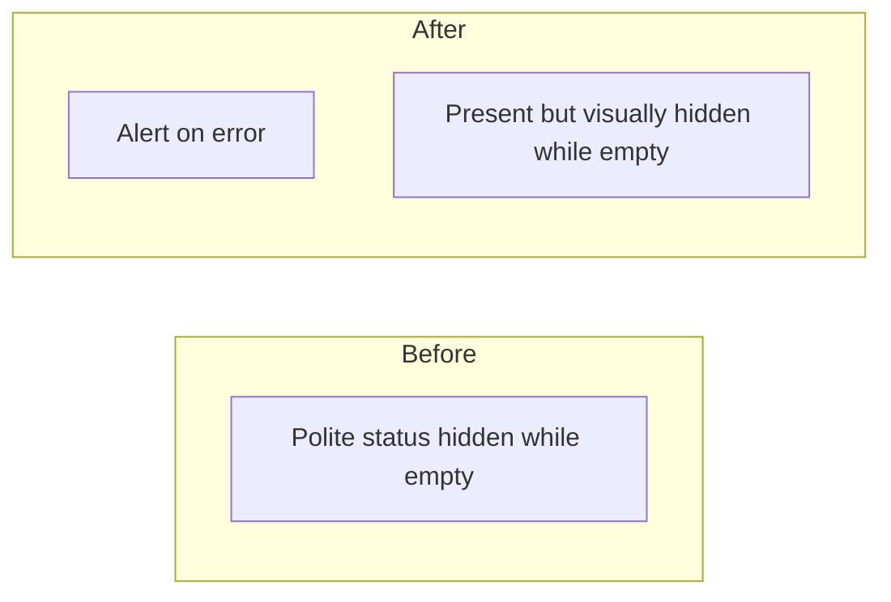

## Scenario

Every auth page — sign in at `/sign-in`, sign up at `/sign-up`, the Passkeys list on Account at `/account`, and device approval at `/device` — is assembled by `page(path, query, message, nonce)` in `auth/better-auth/src/pages.ts:17-58`. Each page carries one shared feedback paragraph, `
`, emitted at `auth/better-auth/src/pages.ts:44`. A live region is an element whose text changes assistive technology announces; `role="status"` with `aria-live="polite"` means the change is announced only after a pause, when the screen reader is idle.

When the user presses Sign in or a passkey action, the browser makes the sign-in form POST or the passkey request to the auth service, and the message appears after the response. The writer is `report(message, tone = "error")` in `auth/better-auth/src/client.ts:8-11`: it puts the message text into `#feedback` and sets the `data-tone` attribute to `error` by default or `success` when a caller passes that tone. The same paragraph therefore carries both outcomes. In the stylesheet `auth/better-auth/src/auth.css:23-31`, `#feedback:empty { display: none }` removes the region while it holds no text, and `:not(:empty)` rules color it with the danger tokens by default and the success tokens when `data-tone="success"`. A client-side passkey failure reported through `report()` therefore stays polite and may be announced too late or not at all, because the region does not exist in the accessibility tree while empty.

Error versus success is carried only by the danger and success color tokens. The project's canonical field error is `FieldError` from `frontend/src/components/ui/field.tsx`, which renders its message with `role="alert"`, the assertive announcement role. No JSON format crosses a browser boundary for the message itself; the text is written directly into the page, which is why the markup must carry the announcement behavior.

## Executive summary

The shared feedback paragraph on the auth pages keeps `role="status"` and `aria-live="polite"` even when `report()` sets an error tone, so client-side passkey errors are not announced assertively. Its `:empty { display: none }` rule also removes the live region until text is injected, which screen readers often miss. Error versus success is carried only by token colors, while the canonical `FieldError` uses `role="alert"`, the assertive announcement role. Switch the region by tone, keep it present while empty, and add a non-color state cue.

## Recommended action

Switch the region to `role="alert"` when the tone is an error, keep it present but visually hidden while empty, and change only its text. Add a text or icon marker if color is the sole state cue.

## Before and after

| | Auth feedback region |
| --- | --- |
| Before | Always a polite status, hidden while empty, with error shown only by color |
| After | An assertive alert on error, present but visually hidden while empty, with a text or icon cue alongside color |

## Expected improvement

Failed sign-ins and failed passkey actions are announced assertively, and the region exists before text arrives so announcements are not missed. This is a structural accessibility improvement; no benchmarks were run, so no speed, line-count, or bundle savings are claimed.

## Alternatives considered

- Leave as is — errors stay polite and the region may be absent until it is too late to announce. Rejected.
- Only remove the `:empty` hiding rule — the region then exists but still announces errors politely and color remains the only state cue. Rejected as incomplete.

## Downside of rejecting

A client-side passkey error can be missed entirely, and success versus error stays distinguishable only by color.

## Verification

With a screen reader, confirm a failed sign-in and a failed passkey action both announce assertively. No test depends on the current strings, so wording can change freely. This is a proposed acceptance check; no screen-reader session was recorded for this audit.

References: `auth/better-auth/src/pages.ts:44`; `auth/better-auth/src/client.ts:8-11`; `auth/better-auth/src/auth.css:23-31`.
