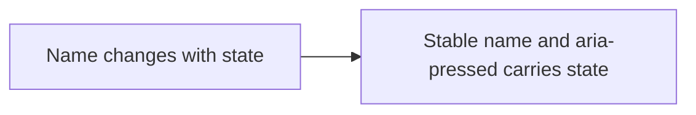

## Scenario

On the Evaluations page and the Outlook forecast, pin buttons on evaluation and funding-gap cards let a user choose whether a card appears on Outlook. The buttons are React `<Button>` components in the frontend at `frontend/src/pages/evaluations/EvaluationCard.tsx:72-92`, `frontend/src/pages/evaluations/CycleFulfillmentCard.tsx:68-84`, `frontend/src/pages/evaluations/FinancialIndependenceCard.tsx:129-141`, and `frontend/src/components/funding/FundingGapsCard.tsx:152-172`. On the Sources connect form, a Show token button reveals the setup token field at `frontend/src/pages/sources/SyncConnectForm.tsx:77-91`. The user presses one of these toggles to change the card's Outlook visibility or the field's visibility.

Nothing crosses a network boundary for the announcement. The browser assembles the name and pressed-state attributes when the card or form renders, and assistive technology announces the accessible name of the focused control. The accessible name is the text a control is labelled by; for these buttons it comes from `title`, `aria-label`, or visible text. `aria-pressed` is the attribute that reports whether a toggle is on or off.

In these buttons the name changes with the state. The pin buttons switch `title` and `aria-label` between `Pin {name} to Outlook` and `Unpin {name} from Outlook` while also setting `aria-pressed={pinned}`. The token button switches its visible text between `Show token` and `Hide token` while setting `aria-pressed={visible}`. When a card is pinned, the announced name says `Unpin ... from Outlook` while the pressed state says true, so the name asserts the opposite of the state and a user cannot tell whether the item is pinned.

The repository already has the correct pattern in pattern review at `frontend/src/components/analysis/PatternReview.tsx:99-120`. Its Confirm and Not buttons keep fixed `aria-label` values, `Confirm {kind} for {title}` and `Not {kind} for {title}`, and let `aria-pressed` carry the state. That stable-name pattern is what the pin and reveal buttons should reuse.

## Executive summary

The pin buttons and the token reveal button change `title` and `aria-label`, the control's accessible name, between "Pin" and "Unpin" or "Show token" and "Hide token" while also setting `aria-pressed`, the attribute that reports a toggle's on or off state. The announced name then asserts the opposite of the pressed state, so a user cannot tell whether the item is pinned. The repository already uses the correct stable-name pattern in pattern review at `frontend/src/components/analysis/PatternReview.tsx`. Keep one name and let `aria-pressed` carry the state.

## Recommended action

Keep one stable name for both `title` and `aria-label` in every state and let `aria-pressed` carry the state. Drop `title` where `aria-label` already names the control. Reuse the pattern-review pattern; nothing new is introduced.

## Before and after

| Control | Before | After |
| --- | --- | --- |
| Pin buttons | Name flips between Pin and Unpin while pressed also changes | One stable name, with `aria-pressed` reporting the state |
| Token reveal button | Name flips between Hide token and Show token | One stable name, with `aria-pressed` reporting the state |

## Expected improvement

Assistive technology reports a constant name and a clear pressed state, so users can tell whether an item is pinned or a token is shown. This is a structural accessibility improvement; no benchmarks were run, so no speed, line-count, or bundle savings are claimed.

## Alternatives considered

- Leave as is — the announced name keeps contradicting the pressed state. Rejected.
- Drop `aria-pressed` and keep the changing name — this removes the contradiction but loses the programmatic state cue and diverges from the repository's own pattern. Rejected.

## Downside of rejecting

The announced name keeps contradicting the pressed state, so a screen-reader user cannot tell whether an item is pinned or a token is revealed.

## Verification

With NVDA or VoiceOver, confirm the name stays constant while only pressed or not pressed changes, for both pin buttons and the token reveal button. This is markup reasoning; no screen-reader session was run. This is a proposed acceptance check, not a recorded result.

References: `frontend/src/components/funding/FundingGapsCard.tsx:156-168`; `frontend/src/pages/evaluations/EvaluationCard.tsx:78-88`; `frontend/src/pages/evaluations/CycleFulfillmentCard.tsx:73-81`; `frontend/src/pages/evaluations/FinancialIndependenceCard.tsx:133-138`; `frontend/src/pages/sources/SyncConnectForm.tsx:77-91`; correct pattern at `frontend/src/components/analysis/PatternReview.tsx:99-120`.
