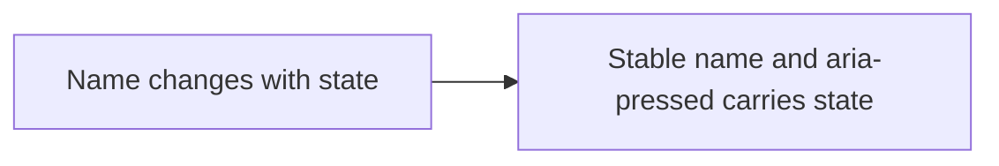

## Scenario

On the Evaluations and Outlook screens, pin buttons on evaluation and funding-gap cards let a user choose whether a card appears on Outlook; on the Sources connect form, a Show token button reveals the setup token field. The user presses the toggle and the button immediately updates both its pressed state — reported to assistive technology by `aria-pressed`, the attribute that says whether a toggle is on — and the name that assistive technology announces. That name currently flips at the same time: pin buttons change their title and aria-label from Pin to Unpin, and the token button changes its visible text from Show token to Hide token. Nothing crosses a network boundary for the announcement; it is markup assembled by the browser when the card or form renders, which is why the announcement is decided by the name and pressed-state attributes. The repository already has the correct pattern in pattern review, where the name stays fixed and only `aria-pressed` changes.

## Executive summary

These native buttons change `title` and `aria-label` (the control's accessible name) between "Pin" and "Unpin" or "Hide token" and "Show token" while also setting `aria-pressed` (the attribute that reports a toggle's on or off state). The announced name then asserts the opposite of the pressed state, so a user cannot tell whether the item is pinned. The repository already uses the correct stable-name pattern in pattern review. Keep one name and let `aria-pressed` carry the state.

## Recommended action

Keep one stable name for both `title` and `aria-label` in every state and let `aria-pressed` carry the state. Drop `title` where `aria-label` already names the control. Reuse the pattern-review pattern; nothing new is introduced.

## Before and after

| Control | Before | After |
| --- | --- | --- |
| Pin buttons | Name flips between Pin and Unpin while pressed also changes | One stable name, with `aria-pressed` reporting the state |
| Token reveal button | Name flips between Hide token and Show token | One stable name, with `aria-pressed` reporting the state |

## Expected improvement

Assistive technology reports a constant name and a clear pressed state, so users can tell whether an item is pinned or a token is shown. This is a structural accessibility improvement; no benchmarks were run, so no speed, line-count, or bundle savings are claimed.

## Alternatives considered

- Leave as is — the announced name keeps contradicting the pressed state. Rejected.
- Drop `aria-pressed` and keep the changing name — this removes the contradiction but loses the programmatic state cue and diverges from the repository's own pattern. Rejected.

## Downside of rejecting

The announced name keeps contradicting the pressed state, so a screen-reader user cannot tell whether an item is pinned or a token is revealed.

## Verification

With NVDA or VoiceOver, confirm the name stays constant while only pressed or not pressed changes, for both pin buttons and the token reveal button. This is markup reasoning; no screen-reader session was run. This is a proposed acceptance check, not a recorded result.

References: `frontend/src/components/funding/FundingGapsCard.tsx:156-168`; `frontend/src/pages/evaluations/EvaluationCard.tsx:78-88`; `frontend/src/pages/evaluations/CycleFulfillmentCard.tsx:73-81`; `frontend/src/pages/evaluations/FinancialIndependenceCard.tsx:133-138`; `frontend/src/pages/sources/SyncConnectForm.tsx:77-91`; correct pattern at `frontend/src/components/analysis/PatternReview.tsx:99-120`.
