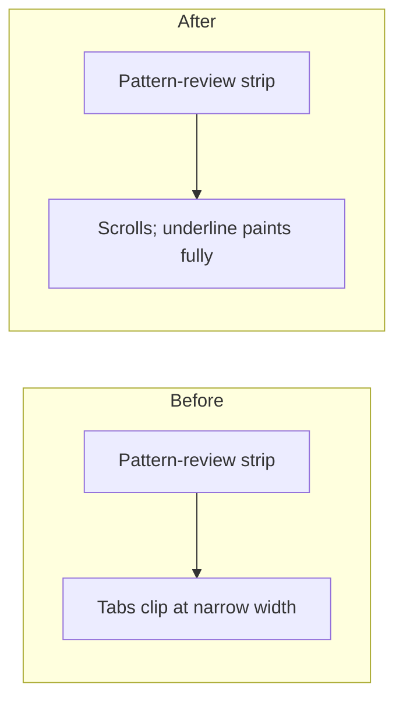

## Scenario

Open the Sources page and select the Analysis tab. Below the findings table sits a Pattern review section listing suggestions the analyzer made about your transactions, such as which saved payment a charge belongs to or whether a payment repeats. Clicking a row opens a dialog where you confirm a suggestion, mark it as not correct, dismiss it, or restore it. Above the list is a strip of three status tabs, Review, Saved and Dismissed, each showing a count.

The browser makes the findings request before any of that is visible. When the Analysis tab opens, the app asks the API for every analysis finding and the API sends back the findings it already stored from an earlier analysis run over the saved bank activity the app uses as evidence. That analysis is run by the API, not started from this screen; the page even shows an "Analysis pending" note while a new run is queued or running. The user starts the review work later, by clicking a row and pressing one of its answer buttons. So the request happens when the tab mounts and repeats on a timer, while the visible rows appear only after the reply arrives.

The reply is JSON: structured text that carries the data as named fields. It contains the list of finding records and a cursor, an opaque marker for where the next page begins; the browser reads pages until the cursor is empty and then re-polls to keep them fresh. The generated API client is code produced from the checked-in API description. For an ordinary JSON reply that description declares the reply shape, so the generated client is the parser here: it converts the raw reply text into typed objects the rest of the app can use. On screen, a domain helper groups those findings into one row per related sequence of charges, called a stream, and decides which status tab each row belongs to by checking whether it is unanswered, confirmed, or rejected or dismissed.

The three status tabs are drawn by a shared tab-strip component. That component takes a boolean prop, an input that switches a behaviour on or off, named `scrollable`. When set, the prop selects a layout recipe, one preset style choice also called a variant, that lets the strip scroll sideways and reserves room below the tabs for the selected underline and the keyboard focus ring, the outline the browser draws around the tab you reach with the keyboard. The component exists so no consumer has to write its own overflow or clipping workarounds in the page markup, and the component guide records this as the contract. The pattern-review strip is the only one of eight tab strips that does not set the prop.

## Executive summary

The pattern-review section on the Sources page's Analysis tab lets a user confirm or correct suggested payment purposes across three status tabs, rendered by the shared tab strip component (`TabsList`). That strip is the only one of eight `TabsList` consumers that does not set `scrollable`. At a narrow viewport the three tabs can clip, and there is no reserved paint space for the selected underline or focus ring. The owning recipe only handles overflow and underline spacing when the prop is set, and the component guide records that contract. Add `scrollable` to that one tab strip.

## Recommended action

Add `scrollable` to the `TabsList` in the pattern-review dialog. Every other consumer already passes it, so this brings the last outlier in line with the documented contract and needs no new component or style.

## Before and after

| Before | After |
| --- | --- |
| The pattern-review status strip renders `TabsList` without `scrollable`; tabs can clip at narrow widths and the underline and focus ring have no reserved space. | The same strip sets `scrollable`, so it scrolls horizontally and reserves underline and focus-ring room, matching the other seven strips. |

## Expected improvement

The strip gains the same horizontal-scroll and underline-spacing behavior as the other seven strips, so the three status tabs stay reachable and the selected underline and focus ring paint fully at narrow widths. This is a structural improvement from reusing an existing recipe branch, not a measured one; no browser benchmark or layout measurement was run for this audit.

## Alternatives considered

- Leave as is — rejected because the strip remains the sole outlier and the clipping and underline issue persists at narrow viewports.
- Change the shared recipe to always scroll — rejected because it would affect all seven strips that rely on the default layout, widening the blast radius; the component guide documents the behavior as opt-in.

## Downside of rejecting

The pattern-review strip stays the only consumer without the flag. At 360px the three status tabs can clip and the underline and focus ring may paint incompletely while the other strips do not, a user-visible inconsistency the component guide already flags as a contract.

## Verification

With the Sources page open on the Analysis tab, narrow the viewport to 360px and confirm the pattern-review status strip scrolls horizontally and the underline and focus ring paint fully. No browser check was run for this audit, so the responsive claim is code-derived and requires visual confirmation.

References: `frontend/src/components/analysis/PatternReview.tsx:372`; `frontend/src/components/ui/tabs.tsx:38-71`; `docs/ui-components.md:59-62`.
