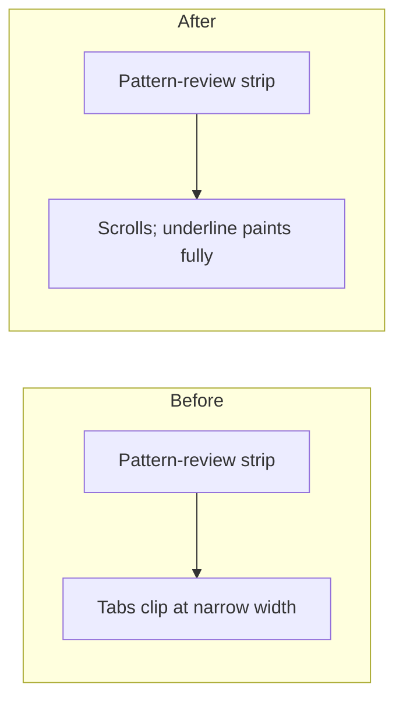

## Executive summary

The pattern-review dialog lets a user confirm or correct suggested payment purposes across three status tabs, rendered by the tab strip component (`TabsList`). That strip is the only one of eight `TabsList` consumers that does not set `scrollable`. At a narrow viewport the three tabs can clip, and there is no reserved paint space for the selected underline or focus ring. The owning recipe only handles overflow and underline spacing when the prop is set, and the component guide records that contract. Add `scrollable` to that one tab strip.

## Recommended action

Add `scrollable` to the `TabsList` in the pattern-review dialog. Every other consumer already passes it, so this brings the last outlier in line with the documented contract and needs no new component or style.

## Before and after

| Before | After |
| --- | --- |
| The pattern-review status strip renders `TabsList` without `scrollable`; tabs can clip at narrow widths and the underline and focus ring have no reserved space. | The same strip sets `scrollable`, so it scrolls horizontally and reserves underline and focus-ring room, matching the other seven strips. |

## Expected improvement

The strip gains the same horizontal-scroll and underline-spacing behavior as the other seven strips, so the three status tabs stay reachable and the selected underline and focus ring paint fully at narrow widths. This is a structural improvement from reusing an existing recipe branch, not a measured one; no browser benchmark or layout measurement was run for this audit.

## Alternatives considered

- Leave as is — rejected because the strip remains the sole outlier and the clipping and underline issue persists at narrow viewports.
- Change the shared recipe to always scroll — rejected because it would affect all seven strips that rely on the default layout, widening the blast radius; the component guide documents the behavior as opt-in.

## Downside of rejecting

The pattern-review strip stays the only consumer without the flag. At 360px the three status tabs can clip and the underline and focus ring may paint incompletely while the other strips do not, a user-visible inconsistency the component guide already flags as a contract.

## Verification

Verify at 360px that the strip scrolls horizontally and the underline and focus ring paint fully. No browser check was run for this audit, so the responsive claim is code-derived and requires visual confirmation.

References: `frontend/src/components/analysis/PatternReview.tsx:372`; `frontend/src/components/ui/tabs.tsx:38-71`; `docs/ui-components.md:59-62`.
