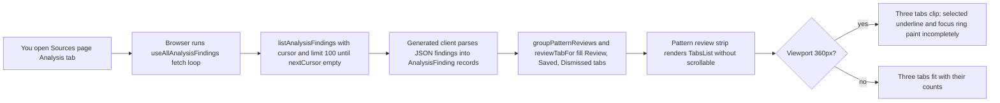
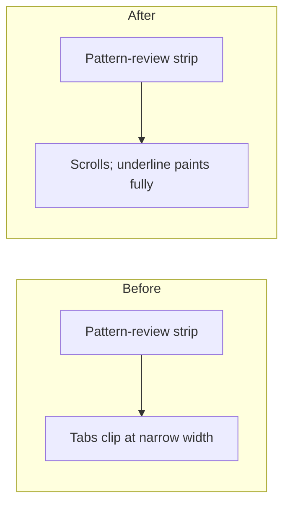

## Scenario

The Sources page has an Analysis tab that shows analysis findings. Below the findings table sits the Pattern review section, a list of suggestions the analyzer produced about saved bank activity, such as which saved payment a charge belongs to or whether a payment repeats. Clicking a row opens a dialog where you confirm a suggestion, mark it as not correct, dismiss it, or restore it. Above the list is a strip of three status tabs, Review, Saved and Dismissed, each showing a count.

The browser fetches the findings before any row appears. The `AnalysisFindings` page component in `frontend/src/pages/sources/AnalysisFindings.tsx` calls `useAllAnalysisFindings` from `frontend/src/state/allAnalysisFindings.ts`. That hook sends the `listAnalysisFindings` request, a generated function in `frontend/src/api/generated/endpoints.ts`, in a loop. Each call carries a `cursor` and `limit: 100`. The cursor is an opaque marker for where the next page begins: the hook starts with an empty cursor, reads `nextCursor` from each reply, and sends that value in the next call until `nextCursor` is empty. The hook sets `staleTime` to 5 seconds and `refetchInterval` to 15 seconds, so the same loop runs again on a timer to keep the rows fresh. The API returns findings from an analysis run it completed earlier over the saved bank activity; that run is not started from this screen, and the page shows an "Analysis pending" note while a new run is queued or running. The user starts the review work later, by clicking a row and pressing an answer button.

The `listAnalysisFindings` reply is JSON, a text format that carries data in named fields: the finding records in `findings` and the `nextCursor`. For a JSON reply the API description declares the reply shape, so the generated client does the parsing: it converts the reply text into typed objects the rest of the app consumes. That client is TypeScript code generated by orval from `frontend/openapi.snapshot.json`, a checked-in file that the `scripts/refresh-openapi` script exports from the API's served contract and that `frontend/orval.config.ts` reads to produce `frontend/src/api/generated/endpoints.ts` and the model files. `AnalysisFinding`, the type of each finding record, is one such generated model.

On screen, `groupPatternReviews` in `frontend/src/domain/patternReview.ts` groups the findings into one row per stream. A stream here is a payment pattern or recurring pattern that ties related charges together; findings with no stream stay as standalone rows. The same file's `reviewTabFor` assigns each row to a tab from its review decisions: a confirmed decision puts the row in Saved, a rejected decision or a dismissal puts it in Dismissed, and an unanswered row stays in Review.

The three status tabs are drawn by `TabsList`, a shared tab-strip component in `frontend/src/components/ui/tabs.tsx`. `TabsList` takes a boolean prop `scrollable`, an input that switches a layout behaviour on or off. Setting `scrollable` selects a class-variance recipe branch, a named preset style choice also called a variant that picks a different set of CSS classes, that makes the strip scroll sideways and reserves bottom padding for the selected underline and the keyboard focus ring, the outline the browser draws around the tab reached with the keyboard. The component exists so no consumer has to write its own overflow or clipping workarounds in page markup, and `docs/ui-components.md` records this as the contract for horizontal tab strips. The Pattern review strip in `frontend/src/components/analysis/PatternReview.tsx` is the only one of eight `TabsList` call sites that does not set `scrollable`.

## Executive summary

The pattern-review section on the Sources page's Analysis tab lets a user confirm or correct suggested payment purposes across three status tabs, rendered by the shared tab strip component (`TabsList`). That strip is the only one of eight `TabsList` consumers that does not set `scrollable`. At a narrow viewport the three tabs can clip, and there is no reserved paint space for the selected underline or focus ring. The owning recipe only handles overflow and underline spacing when the prop is set, and the guide at `docs/ui-components.md` records that contract. Add `scrollable` to that one tab strip.

## Recommended action

Add `scrollable` to the `TabsList` in the pattern-review dialog. Every other consumer already passes it, so this brings the last outlier in line with the documented contract and needs no new component or style.

## Before and after

| Before | After |
| --- | --- |
| The pattern-review status strip renders `TabsList` without `scrollable`; tabs can clip at narrow widths and the underline and focus ring have no reserved space. | The same strip sets `scrollable`, so it scrolls horizontally and reserves underline and focus-ring room, matching the other seven strips. |

## Expected improvement

The strip gains the same horizontal-scroll and underline-spacing behavior as the other seven strips, so the three status tabs stay reachable and the selected underline and focus ring paint fully at narrow widths. This is a structural improvement from reusing an existing recipe branch, not a measured one; no browser benchmark or layout measurement was run for this audit.

## Alternatives considered

- Leave as is — rejected because the strip remains the sole outlier and the clipping and underline issue persists at narrow viewports.
- Change the shared recipe to always scroll — rejected because it would affect all seven strips that rely on the default layout, widening the blast radius; `docs/ui-components.md` documents the behavior as opt-in.

## Downside of rejecting

The pattern-review strip stays the only consumer without the flag. At 360px the three status tabs can clip and the underline and focus ring may paint incompletely while the other strips do not, a user-visible inconsistency `docs/ui-components.md` already flags as a contract.

## Verification

With the Sources page open on the Analysis tab, narrow the viewport to 360px and confirm the pattern-review status strip scrolls horizontally and the underline and focus ring paint fully. No browser check was run for this audit, so the responsive claim is code-derived and requires visual confirmation.

References: `frontend/src/components/analysis/PatternReview.tsx:372`; `frontend/src/components/ui/tabs.tsx:38-71`; `docs/ui-components.md:59-62`.
