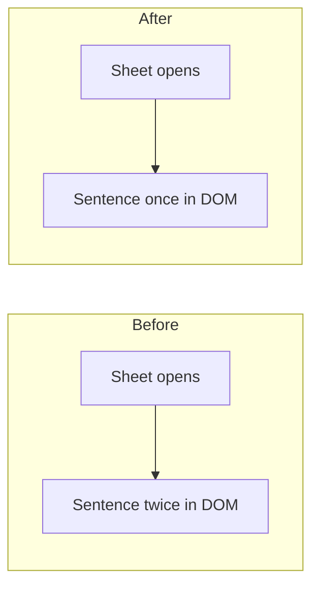

## Executive summary

The suggestions sheet, opened from a transaction, shows the same sentence twice: once as a screen-reader-only `SheetDescription` (the sheet's accessible-description element) and again as a visible paragraph. Assistive technology reaches the sentence twice and two copies of the string must be kept in sync. Keep the screen-reader-only description and delete the visible paragraph, or make the description visible once.

## Recommended action

Keep the screen-reader-only `SheetDescription` and delete the duplicated visible paragraph, or surface the description visibly once. This removes the second copy of the string without adding any component.

## Before and after

| Before | After |
| --- | --- |
| The sentence appears twice: once in the screen-reader-only `SheetDescription` and once in a visible paragraph in the sheet body. | The sentence appears once. The sheet keeps its accessible description and the visible duplicate is gone. |

## Expected improvement

Assistive technology announces the sentence once instead of twice, and there is one string to maintain instead of two. This is a structural improvement to the rendered DOM and the maintenance surface; no performance measurement was run for this audit.

## Alternatives considered

- Leave as is — rejected because the duplicate announcement and two strings to sync remain.
- Delete the screen-reader-only description and keep only the visible paragraph — rejected because the plain paragraph does not provide the sheet's programmatic accessible description on its own.

## Downside of rejecting

Every screen-reader user of the suggestions sheet hears the same sentence twice, and a future wording change must be applied in two places or the visible and announced text diverge.

## Verification

Verify that the phrase occurs once in the DOM and the sheet still has an accessible description.

References: `frontend/src/components/activity/TransactionDetail.tsx:1433,1438`.
