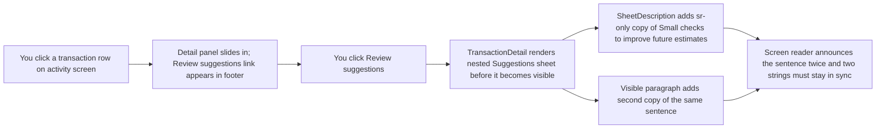
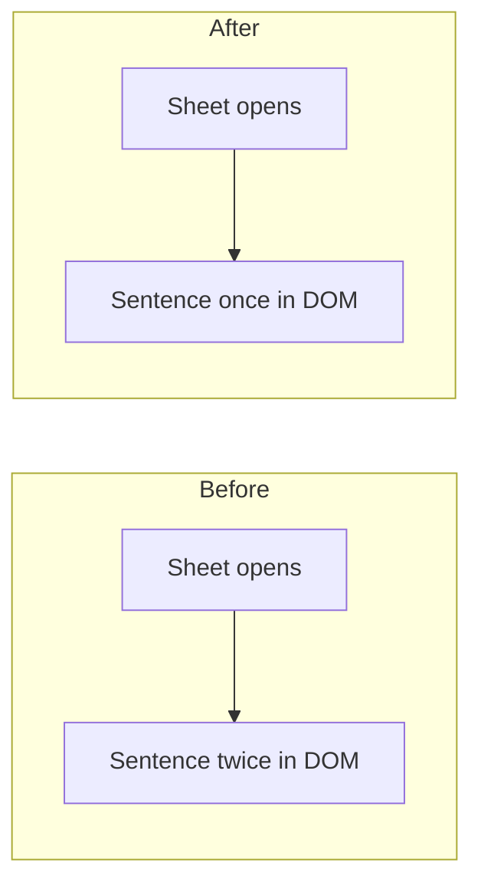

## Scenario

On the activity screen you click a transaction row and a transaction detail panel slides in from the right. When the app has found suggestions for that single transaction, a Review suggestions link appears in the detail panel footer. Clicking that link opens a second, nested panel titled Suggestions. Both the transaction detail panel and the nested Suggestions panel are built by `TransactionDetail` in `frontend/src/components/activity/TransactionDetail.tsx`. The browser renders the nested panel at the moment you click the link, before the panel becomes visible, so both copies of the hint are rendered together as the sheet opens.

To a sighted user the Suggestions panel starts with a short hint line, "Small checks to improve future estimates", above the suggestion rows themselves. A screen reader, software that reads the screen aloud for people who cannot see it, cannot read that hint off the page visually. Instead it relies on the panel's accessible description, a short text the panel publishes through the DOM, the browser's in-memory tree of page elements, so the screen reader can announce what the panel is for when it opens. The `Sheet` UI component in `frontend/src/components/ui/sheet.tsx` exists to publish exactly that description: `SheetDescription` renders the description element and wires it into the accessibility tree, even though the `sr-only` style hides that element from sight. The same `Sheet` component is reused across the app's right-side sheets.

The problem is that the sentence "Small checks to improve future estimates" is written twice in the Suggestions panel. The `SheetDescription` element in `frontend/src/components/activity/TransactionDetail.tsx` holds one copy, and a visible paragraph in the panel body holds the other. Both copies land in the DOM, so a screen reader reaches the sentence twice, and the two copies have to be edited together to keep the announced and visible wording aligned.

## Executive summary

The suggestions sheet, opened from a transaction, writes the sentence Small checks to improve future estimates twice: once in a screen-reader-only description element that publishes the sheet's accessible description, and once as a visible paragraph in the sheet body. Assistive technology therefore reaches the sentence twice, and a wording change must be applied in two places to keep the visible and announced text aligned. Keep the hidden description and delete the visible paragraph, or make the description visible once.

## Recommended action

Keep the screen-reader-only description element and delete the duplicated visible paragraph, or surface that description once as the visible text. The `Sheet` component in `frontend/src/components/ui/sheet.tsx` already exists and its `SheetDescription` publishes the accessible description, so this removes the second copy of the string without adding any component.

## Before and after

| Before | After |
| --- | --- |
| The sentence Small checks to improve future estimates appears twice: once in the screen-reader-only description element and once as a visible paragraph in the sheet body. | The sentence appears once. The sheet keeps its accessible description and the visible duplicate is gone. |

## Expected improvement

Assistive technology announces the sentence once instead of twice, and there is one string to maintain instead of two. This is a structural improvement to the rendered DOM and the maintenance surface; no performance measurement was run for this audit.

## Alternatives considered

- Leave as is — rejected because the duplicate announcement and the two strings to keep in sync remain.
- Delete the screen-reader-only description and keep only the visible paragraph — rejected because a plain paragraph does not provide the sheet's programmatic accessible description on its own.

## Downside of rejecting

Every screen reader user of the suggestions sheet hears the same sentence twice, and any future wording change must be applied in two places or the visible hint and the announced description diverge.

## Verification

With the Suggestions sheet open, verify that the phrase "Small checks to improve future estimates" occurs once in the DOM and that `SheetDescription` still publishes the sheet's accessible description.

References: `frontend/src/components/activity/TransactionDetail.tsx:1433,1438`.
