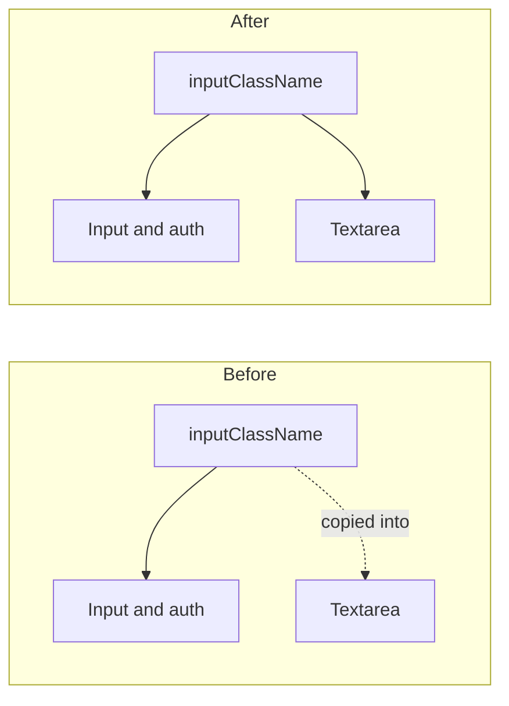

## Scenario

This is a shared UI-control path, not a request that travels to a server. The work starts when the app draws a form in the browser, in the moment just before the control appears on screen; no click or network call triggers it. The concrete screen is the Amounts tab of the Sources page, where a user creates or edits an amount recipe. In that form the person configuring the account types a multi-line list of tax brackets into the Brackets field, which is a block of JSON, meaning plain text used to store structured data, giving each bracket's upper limit per paycheck and a rate from zero to one. That Brackets field is the one place a real screen renders the `Textarea` control. Nearby one-line fields in that builder, such as the deduction, use the `Input` control instead, and the recipe catalog editor uses `Input` for its one-line name and when-to-use fields. A grouped-input textarea wrapper is also exported for composing controls inside groups of inputs, but no screen currently renders it.

A control's appearance is decided by a class list, which is one space-separated string of CSS class names in which each name, called a token, stands for one styling rule such as a border color or a focus ring. `control-styles.ts` declares that class list as a class recipe, meaning a named and reusable definition of a control's look; a variant is a named option in such a recipe that selects a different set of classes. The recipe is shared on purpose because the sign-in pages are plain HTML with no React runtime, so they import the same class list as the React `Input` primitive to keep both renderers looking identical. The class string crosses a rendering boundary rather than a network one: it is assembled in the component and handed to the browser as the element's class attribute right before the control is painted, and that is when the shared focus, invalid, disabled, and dark-mode rules take effect. Callers can add their own classes through the component's className prop, where a prop is simply a value passed into a React component, and the merger reconciles those too.

`Textarea` exists because a multi-line field needs a different surface from a one-line input: it grows with its content and has a minimum height instead of a fixed one, while it should otherwise look exactly the same. To get that look it currently copies the entire shared class list and changes only the sizing tokens. The class merger `cn` is the helper that joins class lists and lets a later token win when two rules conflict. Composing the textarea from the shared list plus its sizing tokens through that merger is what keeps a single visual owner.

## Executive summary

`control-styles.ts` declares one visual owner, the shared class recipe `inputClassName`, for control surface, focus ring, invalid, disabled, and dark states, and it is consumed by `Input` and the React-free auth controls. `Textarea` repeats that whole class chain verbatim and differs only in sizing. Any change to the control contract must be applied in two places and silently leaves textareas behind when the shared recipe changes. Compose the textarea from `inputClassName` plus its sizing overrides so the class merger resolves them.

## Recommended action

Compose `Textarea` from `inputClassName` plus its sizing overrides through the existing class merger, instead of copying the chain. No new recipe or style is needed because the shared owner already exists.

## Before and after

| Before | After |
| --- | --- |
| `Textarea` repeats the full class chain from the shared recipe, with only sizing differences. | `Textarea` composes `inputClassName` with its sizing overrides, inheriting the shared contract automatically. |

## Expected improvement

A single edit to the shared control recipe reaches textareas as well as inputs and auth controls, removing the drift where a focus, invalid, disabled, or dark-state change is applied to inputs but silently missed on textareas. This is a structural maintenance improvement, not a measured one. No benchmark or class-count measurement was run for this audit, so no size savings are claimed.

## Alternatives considered

- Leave as is, rejected because every control-contract change must be duplicated and textareas drift silently.
- Move the textarea-specific classes into the shared recipe as a new variant, rejected because it couples textarea sizing into the general control owner and adds complexity when composition through the existing class merger already works.

## Downside of rejecting

The duplicate chain stays. A future change to focus, invalid, disabled, or dark styling applied to the shared recipe leaves textareas behind, producing inconsistent controls that are easy to miss in review.

## Verification

Verify with typecheck and a comparison of rendered `Input` and `Textarea` class lists for identical focus, invalid, disabled, and dark tokens. Confirm auth controls still use `inputClassName`.

References: `frontend/src/components/ui/textarea.tsx:9`; `frontend/src/components/ui/control-styles.ts:5-9,50-51`; `auth/better-auth/src/controls.ts:11,33`.
