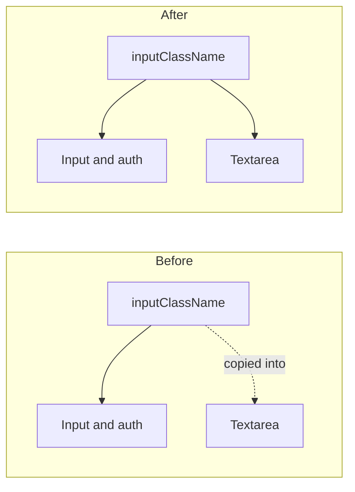

## Executive summary

`control-styles.ts` declares one visual owner — the shared class recipe `inputClassName` — for control surface, focus ring, invalid, disabled, and dark states, consumed by `Input` and the React-free auth controls. `Textarea` repeats that whole class chain verbatim and differs only in sizing. Any change to the control contract must be applied in two places and silently leaves textareas behind when the shared recipe changes. Compose the textarea from `inputClassName` plus its sizing overrides so the class merger (`cn`) resolves them.

## Recommended action

Compose `Textarea` from `inputClassName` plus its sizing overrides through the existing class merger, instead of copying the chain. No new recipe or style is needed; the shared owner already exists.

## Before and after

| Before | After |
| --- | --- |
| `Textarea` repeats the full class chain from the shared recipe, with only sizing differences. | `Textarea` composes `inputClassName` with its sizing overrides, inheriting the shared contract automatically. |

## Expected improvement

A single edit to the shared control recipe reaches textareas as well as inputs and auth controls, removing the drift where a focus, invalid, disabled, or dark-state change is applied to inputs but silently missed on textareas. This is a structural maintenance improvement; no benchmark or class-count measurement was run for this audit, so no size savings are claimed.

## Alternatives considered

- Leave as is — rejected because every control-contract change must be duplicated and textareas drift silently.
- Move the textarea-specific classes into the shared recipe as a new variant — rejected because it couples textarea sizing into the general control owner and adds complexity when composition through the existing class merger already works.

## Downside of rejecting

The duplicate chain stays. A future change to focus, invalid, disabled, or dark styling applied to the shared recipe leaves textareas behind, producing inconsistent controls that are easy to miss in review.

## Verification

Verify with typecheck and a comparison of rendered `Input` and `Textarea` class lists for identical focus, invalid, disabled, and dark tokens. Confirm auth controls still use `inputClassName`.

References: `frontend/src/components/ui/textarea.tsx:9`; `frontend/src/components/ui/control-styles.ts:5-9,50-51`; `auth/better-auth/src/controls.ts:11,33`.
