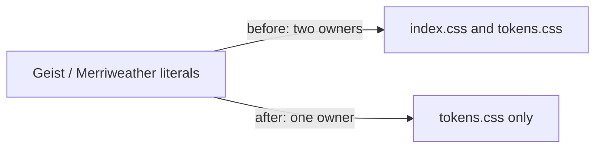

## Scenario

Font selection has no dedicated screen, user action, or request/response boundary. It is an internal styling path used across the whole app. When any screen renders, the browser loads the stylesheets on its own, with no user request or API call, and applies font families to the text: body copy and data use Geist, display headings use Merriweather, and the titles of dialogs, cards, sheets, and alerts use Merriweather too. The fonts are part of what you see the moment the screen renders, and the browser starts the work at render time. Nothing crosses a network boundary and nothing is parsed. What moves between the style files is a set of CSS custom properties, which are named values in a stylesheet, written with a leading pair of dashes, that hold a font family name such as Geist or Merriweather and can be reused wherever that family is needed.

A few terms matter here. A theme is a named group of these values applied together; the app has a light and a dark theme, and the dark one changes colors but keeps the same families. The cascade is the rule that picks a winner when the same name is declared in more than one stylesheet, and when one declaration hides another that is shadowing. The typography rules exist so a family is chosen by the role of the text, whether it is body text, a display heading, or code, rather than by the page it appears on. The title components exist so the titles of cards, dialogs, sheets, alerts, and empty states get the display family along with their own size and weight. The problem this finding addresses is that the family strings are written in two owners, and the title components read a name that the display headings do not, so the two can silently drift apart.

## Executive summary

Body text in this app is set in Geist, while display headings and titles are set in Merriweather. The two family strings are declared in two places. `index.css` declares `--font-sans` and `--font-heading` with literal family names, while `tokens.css` declares the same families as `--font-ui` and `--font-display` and redeclares `--font-sans` to point at `--font-ui`, so the literal in `index.css` is shadowed. Display headings in `typography.css` follow `--font-display`, but `font-heading`, used by five title recipes, stays a literal in `index.css`; changing the documented owner leaves those titles stale. The single action is to keep both family strings only in `tokens.css`.

## Recommended action

Keep the family strings only in `tokens.css`. Point `index.css` at `var(--font-ui)` and `var(--font-display)`, and remove the duplicate `--font-sans` from the `tokens.css` inline theme block. No new token is needed.

## Before and after

| Before | After |
| --- | --- |
| Family strings live in both `index.css` (`--font-sans`, `--font-heading`) and `tokens.css` (`--font-ui`, `--font-display`); `--font-heading` stays a literal while display headings follow `--font-display`. | Family strings live only in `tokens.css`; `index.css` and the five title utilities (card, dialog, sheet, alert dialog, empty state) resolve to `--font-ui` and `--font-display`, and the duplicate `--font-sans` is removed. |

## Expected improvement

Changing the documented font owner updates body text, display headings, and the five title utilities together instead of leaving `font-heading` recipes stale. This is a structural single-owner improvement; no benchmark or rendering measurement was run for this audit.

## Alternatives considered

- Leave as is — rejected because the shadowed literal and second owner remain, so title utilities can silently fall out of sync with display headings.
- Remove `--font-heading` and use `--font-display` directly in the five recipes — rejected because it is a larger change touching five components when redirecting the token in `index.css` achieves the same single owner with less churn.

## Downside of rejecting

The literal in `index.css` stays shadowed and `font-heading` remains a separate owner. A future font change applied to `tokens.css` leaves the card, dialog, sheet, alert, and empty-state titles on the old family while body and display text update, a user-visible inconsistency.

## Verification

Verify with a grep that the Geist and Merriweather literals appear once in `frontend/src/styles` and that computed fonts for body, `h1`, and `font-heading` are unchanged in light and dark themes.

References: `frontend/src/styles/index.css:99-100`; `frontend/src/styles/tokens.css:10-11,72`; `frontend/src/styles/typography.css:21,25`; `frontend/src/components/ui/card.tsx:40`.
