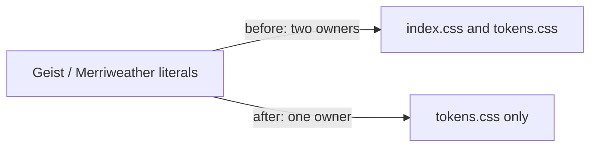

## Executive summary

The font families are declared as CSS custom properties (design tokens). `index.css` declares `--font-sans` and `--font-heading` with literal Geist and Merriweather strings. `tokens.css` already declares those families as `--font-ui` and `--font-display`, and redeclares `--font-sans` to point at `--font-ui`, so the literal in `index.css` is shadowed. More importantly `font-heading`, used by five dialog and card title recipes, stays a literal in `index.css` while display headings in `typography.css` follow `--font-display`; changing the documented owner leaves the title utilities stale. Keep the family strings only in `tokens.css`.

## Recommended action

Keep the family strings only in `tokens.css`. Point `index.css` at `var(--font-ui)` and `var(--font-display)`, and remove the duplicate `--font-sans` from the `tokens.css` inline theme block. No new token is needed.

## Before and after

| Before | After |
| --- | --- |
| Family strings live in both `index.css` (`--font-sans`, `--font-heading`) and `tokens.css` (`--font-ui`, `--font-display`); `--font-heading` stays a literal while display headings follow `--font-display`. | Family strings live only in `tokens.css`; `index.css` and the title utilities resolve to `--font-ui` and `--font-display`, and the duplicate `--font-sans` is removed. |

## Expected improvement

Changing the documented font owner updates body text, display headings, and the five title utilities together instead of leaving `font-heading` recipes stale. This is a structural single-owner improvement; no benchmark or rendering measurement was run for this audit.

## Alternatives considered

- Leave as is — rejected because the shadowed literal and second owner remain, so title utilities can silently fall out of sync with display headings.
- Remove `--font-heading` and use `--font-display` directly in the five recipes — rejected because it is a larger change touching five components when redirecting the token in `index.css` achieves the same single owner with less churn.

## Downside of rejecting

The literal in `index.css` stays shadowed and `font-heading` remains a separate owner. A future font change applied to `tokens.css` leaves dialog and card titles on the old family while body and display text update, a user-visible inconsistency.

## Verification

Verify with a grep that the Geist and Merriweather literals appear once in `frontend/src/styles` and that computed fonts for body, `h1`, and `font-heading` are unchanged in light and dark themes.

References: `frontend/src/styles/index.css:99-100`; `frontend/src/styles/tokens.css:10-11,72`; `frontend/src/styles/typography.css:21,25`; `frontend/src/components/ui/card.tsx:40`.
