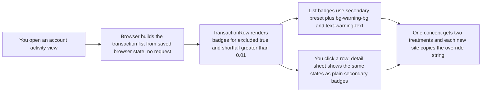
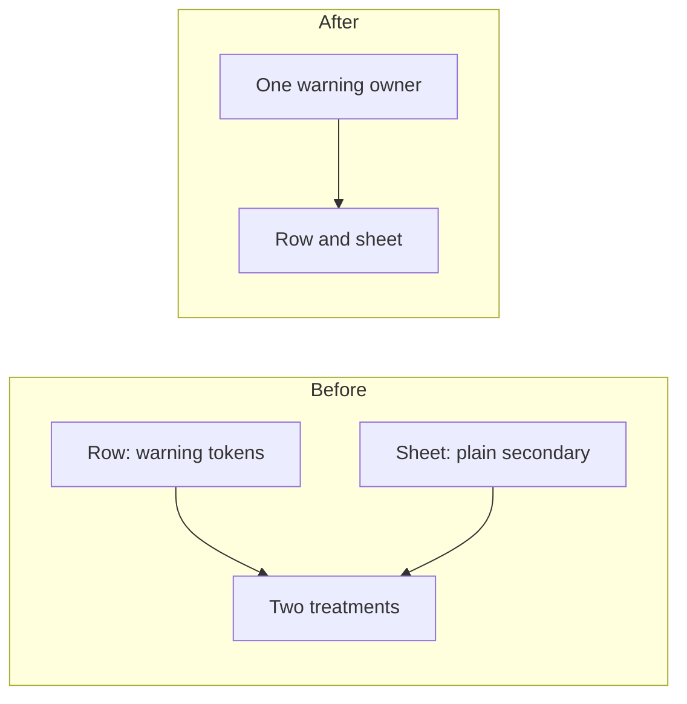

## Scenario

When you open an account's activity view, the app builds a transaction list — a table with one list row per transaction — from the financial model saved in browser state. No request is sent for this view; the rows render from the transaction data already computed from that model. A list row is one line showing a transaction's date, name, and amount, with small status labels called badges attached. A badge is a short pill-shaped label that flags a condition; here the conditions are warnings. The shared row component is `TransactionRow` in `frontend/src/components/activity/TransactionRow.tsx`, and the account activity view builds its list from that component. The data is ordinary transaction information: the amount and date plus flags such as `excluded`, meaning the owner disabled the transaction so it does not count toward the account, and a `shortfall` figure, the gap between what a transaction requested and what actually funded it. The badge styling is applied locally during that render, and the badges are visible as soon as the activity view is drawn, before the owner clicks into anything.

The two warning states are **Excluded from account** and **Shortfall**. Excluded from account appears when `excluded` is true and Shortfall appears when the `shortfall` figure is greater than 0.01. In the transaction list both states are drawn as badges tinted with warning color tokens: `TransactionRow` selects the plain `secondary` badge preset and adds the `bg-warning-bg` and `text-warning-text` classes by hand, where tokens are named color values from the design system that keep colors consistent and adapt between light and dark themes. Clicking a transaction opens the detail sheet — a panel that slides in from the right with that transaction's full details — built by `TransactionDetail` in `frontend/src/components/activity/TransactionDetail.tsx`; the same two states appear there too, but as plain `secondary` badges without the warning tint.

The badges come from the shared `Badge` component in `frontend/src/components/ui/badge.tsx`. That component exposes a variant, a named style preset — a name like `secondary` or `success` that the component maps to a fixed set of CSS classes — so every badge of a given kind looks alike. The Badge component has no warning variant, so each warning badge site repeats the workaround of choosing the plain `secondary` preset and adding the warning color tokens by hand. The prior audit's work on the shared `Badge` component added a success variant for exactly this reason but did not add a warning one, leaving the two warning states to be styled at each site instead of in one owner.

## Executive summary

The shared Badge component owns a set of named style presets, but it has no warning preset. The two transaction warning states, Excluded from account and Shortfall, are therefore styled at each site: the list rows tint them with warning color tokens, while the detail sheet opened from a row shows the same states as plain secondary badges. The same concept gets two visual treatments at two depths, and each new consumer copies the override string. The prior audit's work on the shared `Badge` component covered the success badge, not the warning badge. Add one warning status badge variant, or a single status-badge owner, and use it at both sites.

## Recommended action

Add one warning badge variant to the Badge component's style presets, or consolidate the warning presentation into a single status-badge owner, and use it in the list rows and the detail sheet. This removes the per-site warning color overrides instead of adding another copy. If a new variant is chosen, the existing override strings at the row and sheet sites are deleted in favour of it.

## Before and after

| Before | After |
| --- | --- |
| Row badges add warning surface and text tokens; the detail sheet uses a plain secondary badge for the same states. | One warning badge variant or owner is used at both sites, with one label and one style per state. |

## Expected improvement

The warning states look and label consistently in the list rows and the detail sheet, and a new consumer reuses one owner instead of copying an override string. This is a structural consistency improvement; no browser render or measurement was performed for this audit, so no speedup or bundle saving is claimed.

## Alternatives considered

- Leave as is — rejected because the two treatments and copied overrides remain, so the states look different by depth.
- Apply the row's warning classes to the sheet site only — rejected because it fixes one copy but leaves no single owner, and the same drift returns at the next consumer.
- Add one warning variant to the Badge component — preferred, because it fits the existing preset mechanism that already provides the shared `Badge` success variant, rather than introducing a parallel owner.

## Downside of rejecting

The same excluded or shortfall transaction looks like a warning in the list but like a plain secondary tag in the sheet, and every new surface adds another copy of the override string that can drift. Fixing only one site leaves the two-depth inconsistency in place.

## Verification

Verify by rendering one excluded or shortfall transaction in the row and the detail sheet and comparing computed classes and labels. Confirm that both carry one warning style and label and that no hand-written warning color overrides remain. No browser render was performed for this audit.

References: `frontend/src/components/activity/TransactionRow.tsx:155-170`; `frontend/src/components/activity/TransactionDetail.tsx:1084-1092`.
