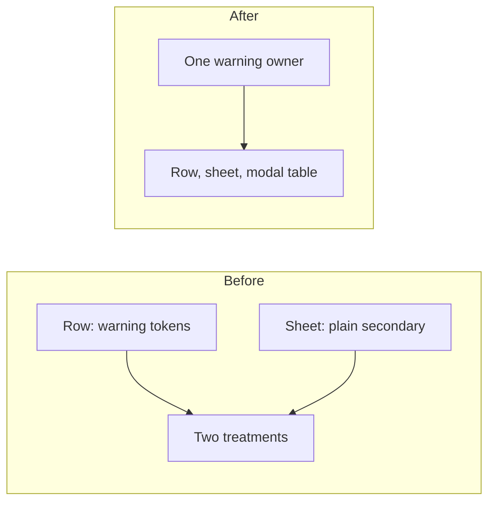

## Executive summary

Two transaction warning states — "Excluded from account" and "Shortfall" — use warning surface and text tokens on the badge in list rows, but a plain secondary variant (a named style preset) in the detail sheet opened from those rows. The same concept gets two visual treatments at two depths, and each new consumer copies the override string. Prior finding 052 covered the success badge, not this one. Add one warning status badge variant or a single status-badge owner and use it at all sites.

## Recommended action

Add one warning badge variant or a single status-badge owner and use it in the list rows, the detail sheet, and the modal table. This removes the per-site override strings instead of adding another copy.

## Before and after

| Before | After |
| --- | --- |
| Row badges add warning surface and text tokens; the detail sheet uses a plain secondary badge for the same states. | One warning badge variant or owner is used at every site, with one label and one style per state. |

## Expected improvement

The warning states look and label consistently in rows, the detail sheet, and the modal table, and a new consumer reuses one owner instead of copying an override string. This is a structural consistency improvement; no browser render or measurement was performed for this audit.

## Alternatives considered

- Leave as is — rejected because the two treatments and copied overrides remain, so the states look different by depth.
- Apply the row's warning classes to the sheet site only — rejected because it fixes one copy but leaves no single owner, and the same drift returns at the modal table or the next consumer.

## Downside of rejecting

The same excluded or shortfall transaction looks like a warning in the list but like a plain secondary tag in the sheet, and every new surface adds another copy of the override string that can drift.

## Verification

Verify by rendering one excluded or shortfall transaction in the row, the detail sheet, and the modal table and comparing computed classes and labels. No browser render was performed for this audit.

References: `frontend/src/components/activity/TransactionRow.tsx:155-170`; `frontend/src/components/activity/TransactionDetail.tsx:1084-1092`.
