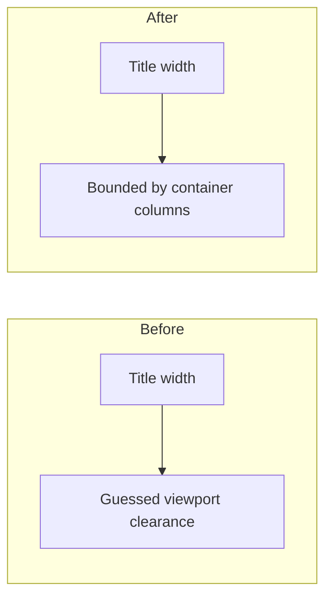

## Executive summary

The shared transaction row caps its title with `max-sm:max-w-[calc(100vw_-_13rem)]`, where `13rem` is a guessed clearance for date, amount, and icon, and also caps it by a character count. The same row renders inside the account-detail dialog and detail sheets, where `100vw` is not the row's width, so titles truncate too early on desktop and not at all in a narrow dialog. Remove both the character cap and the viewport-relative override, keep `min-w-0` on the flex child (the title's layout slot) so it can shrink, and let the existing fixed table columns bound the text.

## Recommended action

Remove the character cap and the viewport-relative max-width from the title, keep `min-w-0` on the flex child, and let the existing fixed table columns bound the text. No new layout rule is needed.

## Before and after

| Before | After |
| --- | --- |
| Title capped by a character count and a viewport-based max-width using a guessed `13rem` clearance; wrong wherever the row is not page-width. | Title bounded by its container and fixed columns through `min-w-0`, consistent on the page, in the account dialog, and in detail sheets. |

## Expected improvement

Titles truncate based on the space the row actually has, so they no longer cut off too early on desktop or overflow in a narrow dialog. This is a structural layout improvement; the responsive claims are code-derived and no visual or benchmark measurement was run for this audit.

## Alternatives considered

- Leave as is — rejected because the guessed clearance stays wrong wherever the row is not page-width.
- Give each container its own max-width override — rejected because it reintroduces the same duplicated, guessed constants this finding removes; container-bound sizing through `min-w-0` is the existing mechanism.

## Downside of rejecting

Long titles keep truncating inconsistently — too short on the desktop page, not at all inside the narrow account dialog and detail sheets — because the clearance is guessed against the viewport rather than the row's real width.

## Verification

Verify at 360px and desktop with a long title in the page table, the account dialog, and the detail sheet. These responsive claims are code-derived and require visual confirmation.

References: `frontend/src/components/activity/TransactionItem.tsx:85-94`; `frontend/src/components/cards/AccountDetailsModal.tsx:136`.
