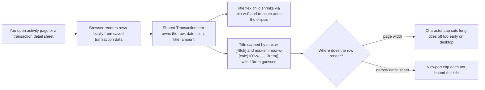
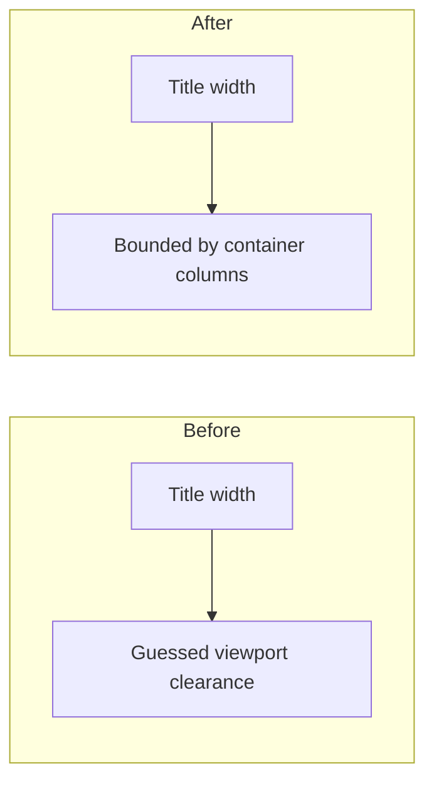

## Scenario

When you open the activity page for an account or open a transaction's detail sheet, the app shows a table of transaction rows. You start the work by opening that screen; there is no separate request you type. The browser renders the rows locally from data the app already holds: transaction records, together with projected occurrences when a forecast has been requested. Each row shows a date, an icon, a title, and an amount. The title is the plain-text name stored on the transaction.

Both surfaces use the same table. A single shared row component, `TransactionItem` in `frontend/src/components/activity/TransactionItem.tsx`, described in its own comment as the "Single visual transaction row", owns the table layout, the class names, and the click-to-view behavior; the screens only supply the transaction data and a handler. The shared row exists so the same row looks and behaves the same everywhere instead of every screen duplicating the table and its interaction.

The layout puts the title in a flex child, meaning a box inside a flex container, which is a row that lets its children share the available width. By default a flex child will not shrink narrower than its own text, so the component relies on the `min-w-0` class, which lets that child shrink below its natural text width. When there is not enough room, the `truncate` class cuts the title short with an ellipsis so it does not widen the table. The date and amount columns hold fixed widths and the title column takes whatever space is left.

The problem appears at the moment the row is drawn. The title is capped twice: once by the `max-w-[48ch]` class, a 48-character maximum, and once by `max-sm:max-w-[calc(100vw_-_13rem)]`, a maximum width computed from the viewport — the visible area of the browser window — on small screens, where `13rem` is a guessed allowance for the side columns. That guessed width only makes sense when the row is as wide as the page. In the detail sheet the row is far narrower than the viewport, so the character cap cuts titles off too early on desktop while the viewport-based cap does not hold them at all inside the narrow sheet.

## Executive summary

The shared transaction row draws the title of every transaction on the activity page and in detail sheets. It is the single row layout that both surfaces reuse, so a mistake in how the title is sized shows up everywhere.

The title is currently capped twice: by a character count and by a viewport-relative maximum width that uses a guessed allowance for the side columns. That only works when the row is as wide as the page. In the detail sheet the row is much narrower, so titles are cut off too early on desktop and are not bounded at all inside the narrow view.

Remove both caps and let the fixed width of the date and amount columns bound the text, keeping the rule that lets the title's layout slot shrink.

## Recommended action

Remove the character cap and the viewport-relative maximum width from the title, keep the shrink rule on the title's flex child, and let the existing fixed-width date and amount columns bound the text. No new layout rule is needed.

## Before and after

| Before | After |
| --- | --- |
| Title capped by a character count and a maximum width derived from the viewport with a guessed allowance for the side columns, so the result is wrong wherever the row is not page-width. | Title bounded by its own container and the fixed date and amount columns through the shrink rule, so it behaves the same on the page and in detail sheets. |

## Expected improvement

Titles truncate based on the space the row actually has, so they no longer cut off too early on desktop or overflow in a narrow detail sheet. This is a structural layout improvement; the responsive claims are code-derived and no visual or benchmark measurement was run for this audit.

## Alternatives considered

- Leave as is — rejected because the guessed clearance stays wrong wherever the row is not page-width.
- Give each container its own maximum-width override — rejected because it reintroduces the same duplicated, guessed constants this finding removes; container-bound sizing through the shrink rule is the existing mechanism.

## Downside of rejecting

Long titles keep truncating inconsistently — too short on the desktop page, not at all inside the narrow detail sheet — because the clearance is guessed against the viewport rather than the row's real width.

## Verification

Verify at narrow phone width and desktop with a long title in the page table and the detail sheet. These responsive claims are code-derived and require visual confirmation.

References: `frontend/src/components/activity/TransactionItem.tsx:69-75`.
