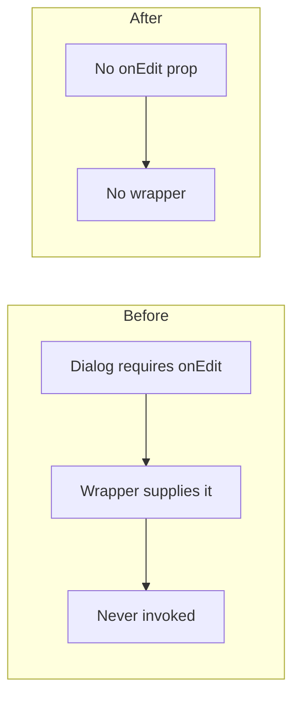

## Scenario

On the Outlook screen the projection chart carries an "Inspect current net worth evidence" control that opens a workspace evidence overlay through an action named `openEvidence`. The component this finding concerns is the other family of evidence overlay: the dialog that explains a forecast result, either the first transaction that runs short of funds or the list of scheduled transactions for the next 30 days. Here "evidence" means that supporting detail, and an "overlay" is a dialog whose open state lives in the page URL so it can be linked or shared. The user reaches these two views through the overlay URL, such as a shared link that names the evidence kind or the return leg of a link coming back from an editor, rather than through a dedicated button. Browser navigation starts the work: a hook named `useWorkspaceOverlays` reads the URL and resolves it into a target, and the app shell mounts an internal component named `WorkspaceEvidence` that asks that hook which dialog is open. When the dialog mounts it asks the API for the forecast, and the table the user reads appears once that reply arrives.

Across the parent-child boundary, the shell passes the dialog three props, which are inputs a parent hands to a child: which evidence view to show, a function to close the dialog, and a function to open an editor. That last input is a callback, a function the child could call to ask the parent to act, and the value supplied is `editFromEvidence`, a wrapper whose only job is to forward that call to `openEditor`. The callback was meant to let a user jump from an evidence row into an editor for that record, but no evidence row calls it; the wrapper exists solely because the dialog's props type demands such a function. The overlay state is owned by `useWorkspaceOverlays`, not by the dialog.

## Executive summary

`EvidenceDialog` renders the supporting detail behind two Outlook forecast results: the first transaction that runs short of funds and the scheduled transactions for the next 30 days. The shell hands it an edit callback that it never calls, supplied through a trivial `editFromEvidence` wrapper that exists only to satisfy the props type. Readers reasonably assume evidence rows can open an editor when they cannot. Remove `onEdit` from the props type, the call site, and the wrapper export.

## Recommended action

Remove `onEdit` from the `EvidenceDialog` props type, drop it from the call site, and remove the `editFromEvidence` wrapper export. No replacement is needed because the callback is never called.

## Before and after

| Before | After |
| --- | --- |
| `EvidenceDialog` requires `onEdit`; the call site passes `editFromEvidence`, a wrapper that exists only to satisfy the type. | The unused prop, its call-site argument, and the wrapper are gone; the dialog's props reflect what it actually does. |

## Expected improvement

The dialog's contract stops advertising an edit action that does not exist, so readers and callers no longer assume evidence rows are editable, and a dead wrapper leaves the codebase. This is a structural cleanup: the component's public surface matches what it actually renders. No runtime, line-count, or bundle measurement was run for this audit, so no measured saving is claimed.

## Alternatives considered

- Leave as is — rejected because the misleading prop and dead wrapper remain, inviting future callers to wire up an action the dialog never triggers.
- Actually implement editing from evidence — rejected as out of scope for this cleanup; it would require new behavior rather than removing an unused contract.

## Downside of rejecting

The unused `onEdit` prop keeps suggesting evidence rows are editable when they are not, and the wrapper persists as a type-satisfying shim that future readers must trace and maintain.

## Verification

Typecheck after removing the prop, and search the workspace to confirm no remaining consumer of the wrapper or the callback.

References: `frontend/src/components/EvidenceDialog.tsx:21-28`; `frontend/src/workspace/WorkspaceDialogs.tsx:67`; `frontend/src/workspace/useWorkspaceOverlays.ts:88,120`.
