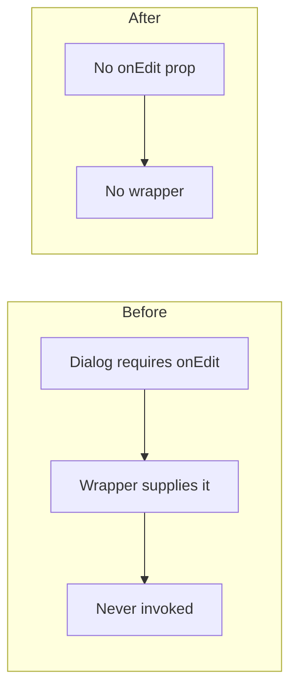

## Executive summary

`EvidenceDialog` requires an `onEdit` prop, supplied through a trivial `editFromEvidence` wrapper, and never invokes it. Readers reasonably assume evidence rows can open an editor when they cannot, and the wrapper exists only to satisfy a type. Remove `onEdit` from the props type, the call site, and the wrapper export.

## Recommended action

Remove `onEdit` from the `EvidenceDialog` props type, drop it from the call site, and remove the `editFromEvidence` wrapper export. No replacement is needed because the callback is never called.

## Before and after

| Before | After |
| --- | --- |
| `EvidenceDialog` requires `onEdit`; the call site passes `editFromEvidence`, a wrapper that exists only to satisfy the type. | The unused prop, its call-site argument, and the wrapper are gone; the dialog's props reflect what it actually does. |

## Expected improvement

The dialog's contract stops advertising an edit action that does not exist, so readers and callers no longer assume evidence rows are editable, and a dead wrapper leaves the codebase. This is a structural cleanup; no runtime or bundle measurement was run for this audit.

## Alternatives considered

- Leave as is — rejected because the misleading prop and dead wrapper remain, inviting future callers to wire up an action the dialog never triggers.
- Actually implement editing from evidence — rejected as out of scope for this cleanup; it would require new behavior rather than removing an unused contract.

## Downside of rejecting

The unused `onEdit` prop keeps suggesting evidence rows are editable when they are not, and the wrapper persists as a type-satisfying shim that future readers must trace and maintain.

## Verification

Verify with typecheck and a grep confirming no remaining consumer.

References: `frontend/src/components/EvidenceDialog.tsx:21-28`; `frontend/src/workspace/WorkspaceDialogs.tsx:67`; `frontend/src/workspace/useWorkspaceOverlays.ts:88,120`.
