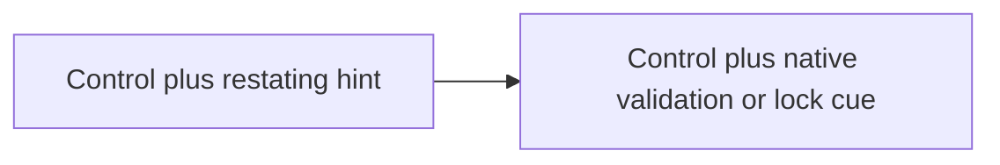

## Executive summary

Several screens carry persistent helper sentences that repeat what the control beside them already says. The scan-window paragraph restates its own label and the input's minimum and maximum bounds. The sign-up hint duplicates the browser's native `minlength` check (the built-in minimum-length rule). Two read-only notices and one configuration note restate disabled fields, a disabled Save button, and the configuration's own field labels. The UI principles already discourage restating the control. The cost is a small but constant attention tax on every viewing. Remove the redundant sentences and keep native validation and the lock indicator as the state cues.

## Recommended action

Delete five pieces of copy: the scan-window sentence, the character-count hint, both read-only restatements, and the configuration field list. Keep native validation and the existing lock indicator as the state cues. Nothing new must be created.

## Before and after

| Screen | Before | After |
| --- | --- | --- |
| Scan window | Paragraph repeats the label, minimum, and maximum | Label and bounded input only |
| Sign up | Hint repeats the character count | Native `minlength` validation only |
| Read-only views | Notices restate disabled fields and the disabled Save button | Lock indicator only |
| Configuration | Note lists its own field labels and Save | Field labels and Save button only |

## Expected improvement

Less repeated text makes each screen easier to scan, and there are fewer strings to keep in step with their labels and bounds, so less drift when a field's rules change. This is a structural improvement only. No benchmarks were run, so no speed, line-count, or bundle savings are claimed.

## Alternatives considered

- Leave as is: the sentences are harmless on their own but keep charging attention on every view and must be updated whenever a label or bound changes.
- Rewrite the hints to add new information instead of deleting them: this adds copy rather than removing it and works against the UI principles.

## Downside of rejecting

The repeated sentences stay on every viewing, and each is a string that must be updated in step with its label, bound, or disabled state; when they drift, the helper text contradicts the control it describes.

## Verification

Confirm the bounded inputs still validate and that read-only still blocks edits and saving after the copy is removed. This is a proposed acceptance check, not a recorded result; no existing test asserts these strings.

References: `frontend/src/pages/sources/GmailProviderPanel.tsx:340`; `auth/better-auth/src/pages.ts:53`; `frontend/src/pages/evaluations/IndependenceConfigure.tsx:368`; `frontend/src/pages/purchase-planner/PlannedPurchaseEditor.tsx:125`; `frontend/src/pages/evaluations/FinancialIndependenceModal.tsx:89`; `docs/UI_UX_PRINCIPLES.md`.
