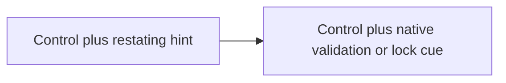

## Scenario

Several settings and editor screens show a helper sentence under a control that already says the same thing. On the Sources screen, the integrations management page shows a Gmail provider section with an Initial scan window number input bounded to 1 through 365 days and a Save scan window button; beneath it sits a sentence describing how far back the first receipt scan looks and repeating those bounds. That sentence is present as soon as the page opens, before the user touches the input, and stays afterward. When the user changes the number and clicks Save, the browser sends that day count to the API. On the identity service's Create an account page, the password field carries a short note about using 8 to 72 characters. The note repeats the browser's built-in minimum-length rule, a check the browser performs on the typed value by itself before any request is sent. In the purchase planner, opening the Add or Edit purchase dialog for a read-only planned purchase shows a notice saying the purchases are read-only, while the fields and Save button are already disabled. In the Financial Independence detail view, the Configure tab shows a note listing the form's own field labels and a line about saving recalculating the projection, while the fields and Save configuration button are already disabled in read-only mode. In every case the text is static copy rendered by the screen, not a parser or data crossing a boundary; the values that do cross a boundary on save are a day count, a password, and configuration fields. The copy was meant to teach on first use, but because it is always visible it spends attention on every visit and repeats what the label, the bounds, the native validation, and the disabled state already communicate. Native validation means the browser checking an entered value before sending it, and read-only means a record can be viewed but not changed.

## Executive summary

Several screens carry persistent helper sentences that repeat what the control beside them already says. The scan-window paragraph restates its own label and the input's minimum and maximum bounds. The sign-up note duplicates the browser's built-in minimum-length rule for the password field. Two read-only notices and one configuration note restate disabled fields, a disabled Save button, and the configuration's own field labels. The UI principles already say that a disabled control and a lock cue show a read-only state without a sentence saying it again. The cost is a small but constant attention tax on every viewing. Remove the redundant sentences and keep the native validation and disabled-state cues that already carry the same information.

## Recommended action

Delete five pieces of copy: the scan-window sentence, the character-count note, both read-only restatements, and the configuration field list. Keep native validation and the existing disabled-state cues, including any lock icon the view already shows, as the state signals. Nothing new must be created.

## Before and after

| Screen | Before | After |
| --- | --- | --- |
| Scan window | Paragraph repeats the label, minimum, and maximum | Label and bounded input only |
| Sign up | Note repeats the character count | Native validation only |
| Read-only views | Notices restate disabled fields and the disabled Save button | Disabled fields and disabled Save only |
| Configuration | Note lists its own field labels and Save | Field labels and Save button only |

## Expected improvement

Less repeated text makes each screen easier to scan, and there are fewer strings to keep in step with their labels and bounds, so less drift when a field's rules change. This is a structural improvement only. No benchmarks were run, so no speed, line-count, or bundle savings are claimed.

## Alternatives considered

- Leave as is: the sentences are harmless on their own but keep charging attention on every view and must be updated whenever a label or bound changes.
- Rewrite the hints to add new information instead of deleting them: this adds copy rather than removing it and works against the UI principles.

## Downside of rejecting

The repeated sentences stay on every viewing, and each is a string that must be updated in step with its label, bound, or disabled state; when they drift, the helper text contradicts the control it describes.

## Verification

Confirm the bounded inputs still validate and that read-only still blocks edits and saving after the copy is removed. This is a proposed acceptance check, not a recorded result; no existing test asserts these strings.

References: `frontend/src/pages/sources/GmailProviderPanel.tsx:340`; `auth/better-auth/src/pages.ts:53`; `frontend/src/pages/evaluations/IndependenceConfigure.tsx:368`; `frontend/src/pages/purchase-planner/PlannedPurchaseEditor.tsx:125`; `frontend/src/pages/evaluations/FinancialIndependenceModal.tsx:89`; `docs/UI_UX_PRINCIPLES.md`.
