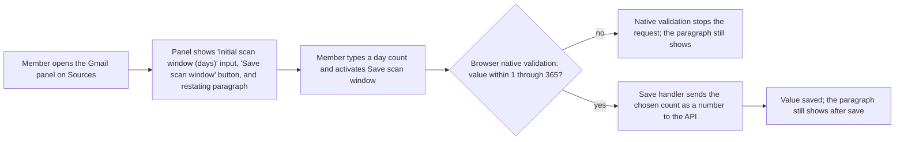
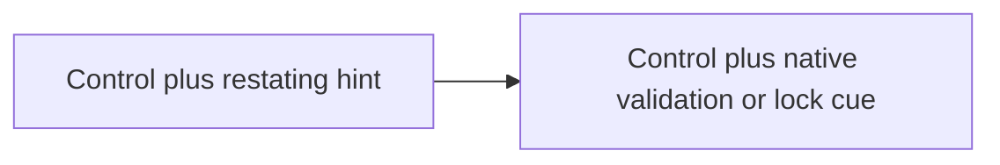

## Scenario

On the Sources screen, the Gmail integration panel shows the control for the first receipt scan. A number input labelled "Initial scan window (days)" accepts 1 through 365, and a "Save scan window" button sits below it. Under the input a paragraph reads "How far back the first receipt scan looks, from 1 to 365 days." The paragraph is static copy rendered by the panel component as soon as the panel opens, before the member edits the number, and it stays after the save. When the member changes the number and activates the button, a save handler sends the chosen day count as a number to the API. The browser's native validation rejects a value outside 1 through 365 before that request is sent; native validation means the browser checks the typed value against the input's minimum and maximum attributes on its own.

On the identity service's Create an account page, the password input in the server-rendered HTML form carries a minimum length of 8 and a maximum length of 72 and a linked note reading "Use 8–72 characters." The browser checks the 8-character minimum when the form is submitted, before the username and password reach the identity service. The note restates that same rule.

In the purchase planner, opening the Add purchase or Edit purchase dialog for a planned purchase in read-only mode shows an alert reading "These planned purchases are read-only." The dialog's fields already sit in a disabled field set and the "Add purchase" or "Save purchase" button is already disabled, so no edit or save request can start. Read-only means the record can be viewed but not changed.

In the Financial Independence detail view, the Configure tab shows a note reading "Minimum net worth, spending test duration, and funding sources. Saving recalculates the projection." The Configure form renders those fields and a "Save configuration" button directly below the note. In read-only mode the Configure form disables its field sets and its "Save configuration" button and shows a second note reading "Read-only mode blocks configuration changes."

All five passages are static copy. Some parts restate labels or controls; others explain limits, access, or what saving does. Native input bounds and disabled controls do not necessarily communicate those details before someone tries to proceed.

## Executive summary

Five helper passages repeat some information already communicated by the controls. Shorten them where the same information is already visible, and keep any instruction that tells people something new.

## Recommended action

Remove only the repeated information from the five passages. Preserve limits people cannot see before submitting, any read-only explanation that is otherwise missing, and consequences of saving that the control does not communicate. Keep the existing validation and read-only behavior.

## Before and after

| Screen | Before | After |
| --- | --- | --- |
| Gmail scan window | Paragraph repeats the input's label and explains the bounds | Keep the bounds visible and remove the repeated description |
| Create an account | Note explains the password length rule | Keep the rule available before submission |
| Planned purchase dialog | Alert explains the disabled state | Keep the explanation if the dialog has no other read-only cue |
| Financial Independence Configure tab | Notes list fields, explain read-only mode and describe the effect of saving | Remove the repeated field list and preserve information the controls do not communicate |

## Expected improvement

Each screen carries less repeated text while keeping information needed to enter valid values or understand what the controls do.

## Alternatives considered

- Leave as is: the sentences are harmless on their own but keep charging attention on every view and must be updated whenever a label or bound changes.
- Delete every hint: that would also remove rules and explanations people may need before interacting with the controls.

## Downside of rejecting

Repeated text can drift from the control it describes.

## Verification

Confirm the scan-window input still rejects values outside 1 through 365, the password field still enforces the 8-character minimum, and the planned-purchase dialog and Configure form still block edits and saving after the copy is removed. This is a proposed acceptance check, not a recorded result; no existing test asserts these strings.

Check that the revised copy still communicates limits before submission, preserves the explanation of read-only mode where needed, and tells people when saving recalculates the projection.

References: `frontend/src/pages/sources/GmailProviderPanel.tsx:340`; `auth/better-auth/src/pages.ts:53`; `frontend/src/pages/evaluations/IndependenceConfigure.tsx:368`; `frontend/src/pages/purchase-planner/PlannedPurchaseEditor.tsx:125`; `frontend/src/pages/evaluations/FinancialIndependenceModal.tsx:89`; `docs/UI_UX_PRINCIPLES.md`.
