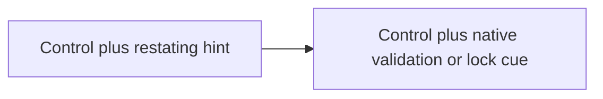

## Scenario

On the Sources screen, the Gmail integration panel shows the control for the first receipt scan. A number input labelled "Initial scan window (days)" accepts 1 through 365, and a "Save scan window" button sits below it. Under the input a paragraph reads "How far back the first receipt scan looks, from 1 to 365 days." The paragraph is static copy rendered by the panel component as soon as the panel opens, before the member edits the number, and it stays after the save. When the member changes the number and activates the button, a save handler sends the chosen day count as a number to the API. The browser's native validation rejects a value outside 1 through 365 before that request is sent; native validation means the browser checks the typed value against the input's minimum and maximum attributes on its own.

On the identity service's Create an account page, the password input in the server-rendered HTML form carries a minimum length of 8 and a maximum length of 72 and a linked note reading "Use 8–72 characters." The browser checks the 8-character minimum when the form is submitted, before the username and password reach the identity service. The note restates that same rule.

In the purchase planner, opening the Add purchase or Edit purchase dialog for a planned purchase in read-only mode shows an alert reading "These planned purchases are read-only." The dialog's fields already sit in a disabled field set and the "Add purchase" or "Save purchase" button is already disabled, so no edit or save request can start. Read-only means the record can be viewed but not changed.

In the Financial Independence detail view, the Configure tab shows a note reading "Minimum net worth, spending test duration, and funding sources. Saving recalculates the projection." The Configure form renders those fields and a "Save configuration" button directly below the note. In read-only mode the Configure form disables its field sets and its "Save configuration" button and shows a second note reading "Read-only mode blocks configuration changes."

All five passages are static copy: four are rendered by React components under `frontend/src/pages/` and one is written into the HTML template in the identity service. No parser is involved because no data format is being decoded. The values that actually cross an API boundary are the selected scan-window day count, the sign-up password, and the saved configuration fields. The passages were written to teach on first use, but each one renders on every visit and repeats what the label, the bounds, the browser's own validation, or the disabled state already says.

## Executive summary

Five persistent helper passages repeat what the control beside each one already communicates. The Gmail scan-window paragraph restates the input's label and its 1-through-365 bounds. The sign-up note duplicates the browser's built-in 8-character minimum for the password field. The planned-purchase alert and the Configure tab's read-only note restate disabled fields and a disabled save button, and the Configure tab's other note lists the form's own field labels and the effect of saving. The UI principles state that a disabled control, a lock icon, and a status readout together say "read-only" and that a sentence saying it again is not information, and they allow hint text only for non-obvious behavior or consequential qualifications. The cost is a small attention tax on every viewing and five strings that must be updated whenever a label or bound changes. Delete the five passages and keep the native validation and disabled-state cues that already carry the same information.

## Recommended action

Delete the five exact sentences: the Gmail "How far back the first receipt scan looks, from 1 to 365 days." paragraph, the "Use 8–72 characters." note, the "These planned purchases are read-only." alert, the "Read-only mode blocks configuration changes." note, and the "Minimum net worth, spending test duration, and funding sources. Saving recalculates the projection." note. Keep the input bounds, the password input's native minimum length, the disabled field sets, the disabled buttons, and any lock cue the view already shows as the state signals. Nothing new must be created.

## Before and after

| Screen | Before | After |
| --- | --- | --- |
| Gmail scan window | Paragraph repeats the input's label and its 1-through-365 bounds | Label and bounded input only |
| Create an account | Note restates the password's 8-to-72-character rule | Native validation only |
| Planned purchase dialog | Alert restates disabled fields and a disabled save button | Disabled fields and disabled save button only |
| Financial Independence Configure tab | Notes restate the read-only state and list the form's own field labels | Field labels and Save configuration button only |

## Expected improvement

Each screen carries less repeated text, so the member sees the control and its state instead of a sentence restating them, and there are five fewer strings to keep in step with their labels, bounds, and disabled states. This is a structural improvement only. No benchmarks were run, so no speed, line-count, or bundle savings are claimed.

## Alternatives considered

- Leave as is: the sentences are harmless on their own but keep charging attention on every view and must be updated whenever a label or bound changes.
- Rewrite the hints to add new information instead of deleting them: this adds copy rather than removing it and works against the UI principles' rule that most hint text should not exist.

## Downside of rejecting

The five sentences stay on every viewing, and each is a string that must be updated in step with its label, bound, or disabled state; when they drift, the helper text contradicts the control it describes.

## Verification

Confirm the scan-window input still rejects values outside 1 through 365, the password field still enforces the 8-character minimum, and the planned-purchase dialog and Configure form still block edits and saving after the copy is removed. This is a proposed acceptance check, not a recorded result; no existing test asserts these strings.

References: `frontend/src/pages/sources/GmailProviderPanel.tsx:340`; `auth/better-auth/src/pages.ts:53`; `frontend/src/pages/evaluations/IndependenceConfigure.tsx:368`; `frontend/src/pages/purchase-planner/PlannedPurchaseEditor.tsx:125`; `frontend/src/pages/evaluations/FinancialIndependenceModal.tsx:89`; `docs/UI_UX_PRINCIPLES.md`.
