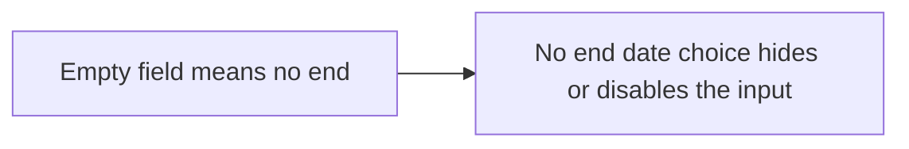

## Scenario

Inside a group's detail view on the Groups page, the "My sharing" section is where one member decides whether to automatically share that member's own transactions with that group. The section renders inside the group detail view rather than on a separate screen, and sharing starts off because nobody else can turn it on. The member selects accounts with the account toggles, fills the "Share from" date and the "Share until" date, then activates "Turn on sharing". When sharing is already on, the member activates "Save changes" instead.

As the member edits the draft, a 350-millisecond debounce lets the values settle before the component sends a preview request. A debounce is a short timer that waits for typing to stop so each keystroke does not start a request. The preview request is a POST to the sharing-policy preview endpoint, sent by the group detail view through the sharing API function `previewSharingPolicy`. Its JSON body carries the selected account identifiers and the two date strings and carries no enabled flag, and it persists nothing. The API counts the member's transactions that match those accounts and dates and returns counts only: the eligible transaction count, the member count, and the account and date values. The section shows that count in the "Before sharing" alert while the preview is pending or ready, so the member sees the exposure before sharing is switched on.

When the member activates "Turn on sharing", the component sends the save request: a PUT to the sharing-policy endpoint through `setSharingPolicy`, with a JSON body carrying the enabled flag set to true plus the same account identifiers and date strings. A policy is the saved set of sharing preferences for that member and that group. The saved policy changes what group members can see, and narrowing accounts or dates revokes access that no longer matches.

The "Share until" input is a native date input, which has no "no end" state of its own. The current design therefore expresses an open-ended share, meaning a share with no end date, by leaving the field empty: the draft holds an empty string, both requests send `endDate` as an empty string, and the preview sentence reads "with no end". The field label currently reads "Share until (empty for no end)" to explain that. No parser decodes the empty value; the empty text simply becomes an empty string at the API boundary.

## Executive summary

Open-ended sharing is encoded in a label instead of in a control: the field reads "Share until (empty for no end)" and relies on a parenthetical note to explain that an empty value means no end date. The preview request already reports the same case as "with no end", so the label repeats a rule that the preview sentence already shows. The UI principles prefer an explicit choice, such as a "No end date" checkbox, over a sentence about leaving a field empty. Rename the label to "Share until" and add an explicit "No end date" choice that hides or disables the date input when selected, so the no-end state is shown by a control rather than by a note.

## Recommended action

Change the label from "Share until (empty for no end)" to "Share until" and introduce a "No end date" choice that owns the open-ended state. When that choice is selected, hide or disable the date input. This reuses the existing "Share until" field and the existing preview and save requests; no new screen is needed.

## Before and after

| Aspect | Before | After |
| --- | --- | --- |
| Label | "Share until (empty for no end)" | "Share until" |
| Open-ended state | Expressed by leaving the field empty | Explicit "No end date" choice |
| Date input | Always active | Hidden or disabled when no end is chosen |

## Expected improvement

The no-end state becomes visible in the control instead of living in a parenthetical note, and the label no longer carries an instruction that the preview sentence "with no end" already communicates. This is a structural improvement only. No benchmarks were run, so no speed, line-count, or bundle savings are claimed.

## Alternatives considered

- Leave as is: this keeps the parenthetical-in-label pattern the UI principles reject.
- Keep the empty-means-open behaviour and only shorten the label to "Share until": this drops the explanation and leaves the no-end state implicit again.

## Downside of rejecting

The field keeps relying on the parenthetical "(empty for no end)" to explain that an empty value means no end date, which is the ambiguity the UI principles call out. A member must read a sentence in the label to understand a state that a control could show.

## Verification

Confirm that with the "No end date" choice selected the save request still stores an empty end date and the preview sentence still reads "with no end"; selecting a date still sends a date string and the preview reads "to" followed by that date. This is a proposed acceptance check, not a recorded result.

References: `frontend/src/pages/GroupSharingSection.tsx:364`; `docs/UI_UX_PRINCIPLES.md:338-345`.
