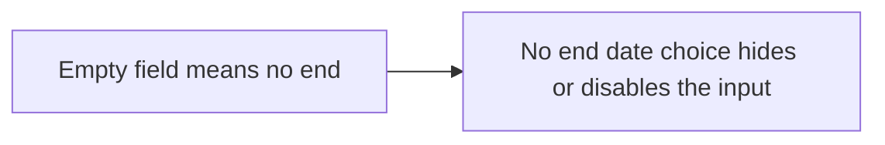

## Executive summary

The share-until field currently bakes the open-ended case into its label as "Share until (empty for no end)". That is the exact pattern the hint policy rejects: instructions about leaving a field empty embedded in the label instead of an explicit structure that communicates the state. The field's meaning ends up depending on a parenthetical sentence. Rename the label to "Share until" and add an explicit "No end date" choice that hides or disables the date input when selected, so an open-ended share is shown by a control rather than a note.

## Recommended action

Change the label to "Share until" and introduce a "No end date" choice that owns the open-ended state. When that choice is selected, hide or disable the date input. This reuses the existing field; no new screen is needed.

## Before and after

| Aspect | Before | After |
| --- | --- | --- |
| Label | "Share until (empty for no end)" | "Share until" |
| Open-ended state | Expressed by leaving the field empty | Explicit "No end date" choice |
| Date input | Always active | Hidden or disabled when no end is chosen |

## Expected improvement

The open-ended state becomes explicit and self-describing, and the preview already reads "with no end", so the label no longer needs a sentence about emptiness. This is a structural improvement only. No benchmarks were run, so no speed, line-count, or bundle savings are claimed.

## Alternatives considered

- Leave as is: this keeps the parenthetical-in-label pattern the policy rejects.
- Keep the empty-means-open behaviour and only shorten the label: this drops the explanation and leaves the state implicit again.

## Downside of rejecting

The field keeps relying on a parenthetical note to explain that an empty value means "no end", which is the ambiguity the hint policy calls out. Users must read the label sentence to understand the state instead of seeing it in the control.

## Verification

Confirm that an unset end still saves as open-ended and the preview still reads "with no end" after the label and choice change. This is a proposed acceptance check, not a recorded result.

References: `frontend/src/pages/GroupSharingSection.tsx:364`; `docs/UI_UX_PRINCIPLES.md:338-345`.
