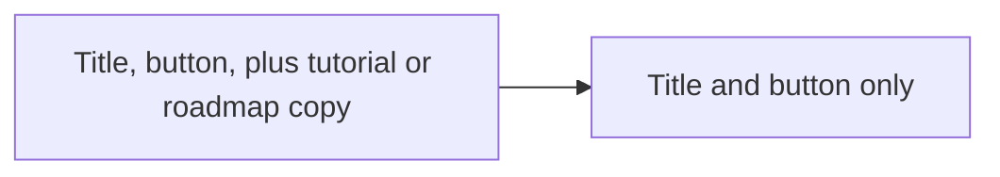

## Executive summary

Two empty states carry copy that does the wrong job. The inbox empty state announces an unbuilt feature, and its header note restates the Accept and Decline buttons while duplicating both the nearby declined empty state and the accepted copy text. The outlook empty state adds a tutorial paragraph on top of a title and button that already stage the single action. The buttons and per-card copy already explain what to do, so the extra text is noise. Remove the split-requests roadmap string, the header note, and the outlook empty-state description.

## Recommended action

Delete the split-requests roadmap string and the header note from the inbox empty state, and delete the outlook empty-state description. Keep the existing buttons and per-card copy as the explanation; no new copy is needed.

## Before and after

| Empty state | Before | After |
| --- | --- | --- |
| Inbox | Roadmap string about split requests plus a header note restating the buttons | Buttons and per-card copy only |
| Outlook | Title, button, and a tutorial paragraph | Title and button only |

## Expected improvement

Empty states point straight to the action without tutorial or roadmap noise, and there is one less announcement of an unbuilt feature to keep in sync with the roadmap. This is a structural improvement only. No benchmarks were run, so no speed, line-count, or bundle savings are claimed.

## Alternatives considered

- Leave as is: the roadmap string promises an unbuilt feature and the notes restate controls that are already on screen.
- Rewrite the roadmap string as a neutral placeholder: this still announces future work and adds copy rather than removing it.

## Downside of rejecting

The inbox keeps advertising an unbuilt feature and restating its own buttons, and the outlook keeps a tutorial paragraph above a button that already says what to do, so users read redundant text before reaching the action.

## Verification

Confirm that accept and decline still explain themselves through their buttons and card copy, and that a search for the roadmap string returns nothing. This is a proposed acceptance check, not a recorded result.

References: `frontend/src/pages/InboxPage.tsx:78,314`; `frontend/src/pages/Outlook.tsx:63`.
