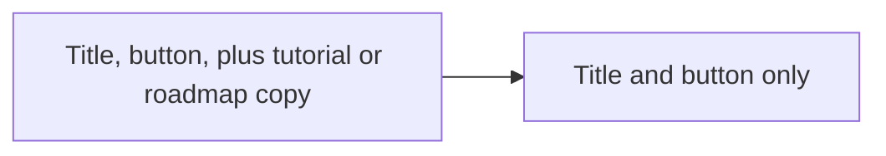

## Scenario

The Inbox is the tabbed screen where a member reviews shares other people sent them, with tabs for pending, accepted, declined, and canceled items. When the browser loads the inbox list from the API and a tab has no items, that tab shows an empty state: a title and a short description. The member reaches it simply by opening the Inbox and selecting a tab, before any Accept or Decline action; those actions live on cards and appear only when there is something to decide. The pending empty state currently says shared transactions appear there and that split requests are coming later, which announces work that does not exist yet. Above the tabs, a note tells the member to accept to save a copy and decline to leave the sender's list, repeating what the Accept and Decline buttons and the other tabs' copy already say. The Outlook workspace home shows a similar empty state when the browser loads the account and balance data and finds no accounts: a title, a button to add the first account, and a paragraph listing later steps. The button already starts the only action there, so the paragraph is tutorial copy. In both cases the only data crossing the boundary is the list that comes back empty, share records for the Inbox and accounts for Outlook, and there is no parser or special format involved. The empty-state text is static copy meant to orient a new user, but it shows on every visit with no action taken and either repeats the controls or promises future work. An empty state is the message shown when a list has no items, and a roadmap statement is one that announces unbuilt features.

## Executive summary

Two empty states carry copy that does the wrong job. The inbox empty state announces an unbuilt feature, and its header note restates the Accept and Decline buttons while duplicating both the nearby declined empty state and the accepted copy text. The outlook empty state adds a tutorial paragraph on top of a title and button that already stage the single action. The buttons and per-card copy already explain what to do, so the extra text is noise. Remove the split-requests roadmap string, the header note, and the outlook empty-state description.

## Recommended action

Delete the split-requests roadmap string and the header note from the inbox empty state, and delete the outlook empty-state description. Keep the existing buttons and per-card copy as the explanation; no new copy is needed.

## Before and after

| Empty state | Before | After |
| --- | --- | --- |
| Inbox | Roadmap string about split requests plus a header note restating the buttons | Buttons and per-card copy only |
| Outlook | Title, button, and a tutorial paragraph | Title and button only |

## Expected improvement

Empty states point straight to the action without tutorial or roadmap noise, and there is one less announcement of an unbuilt feature to keep in sync with the roadmap. This is a structural improvement only. No benchmarks were run, so no speed, line-count, or bundle savings are claimed.

## Alternatives considered

- Leave as is: the roadmap string promises an unbuilt feature and the notes restate controls that are already on screen.
- Rewrite the roadmap string as a neutral placeholder: this still announces future work and adds copy rather than removing it.

## Downside of rejecting

The inbox keeps advertising an unbuilt feature and restating its own buttons, and the outlook keeps a tutorial paragraph above a button that already says what to do, so users read redundant text before reaching the action.

## Verification

Confirm that accept and decline still explain themselves through their buttons and card copy, and that a search for the roadmap string returns nothing. This is a proposed acceptance check, not a recorded result.

References: `frontend/src/pages/InboxPage.tsx:78,314`; `frontend/src/pages/Outlook.tsx:63`.
