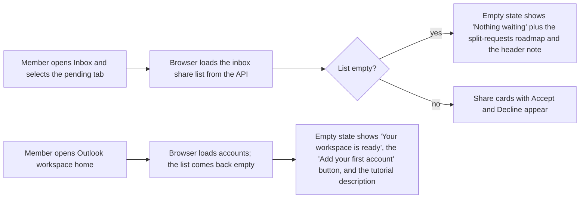
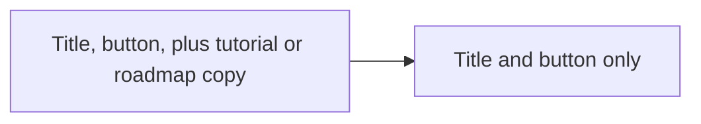

## Scenario

The Inbox is the tabbed screen where a member reviews shares other people sent them, with tabs for pending, accepted, declined, and canceled items. When the browser loads the inbox list from the API and a tab has no share records, that tab renders an empty state made of a title and a description. The member reaches the empty state by opening the Inbox and selecting a tab, before any Accept or Decline action; those actions live on share cards and appear only when a share is waiting for a decision. The pending empty state is titled "Nothing waiting" with the description "Shared transactions appear here; split requests are coming later." The second sentence announces a feature that does not exist yet. Above the tabs a note reads "Accept to save your own copy; decline to leave the sender's list." The accepted tab's empty state says "Accepted shares are saved as independent copies." and the declined tab's empty state says "Declining a direct share removes you from the sender's sharing list.", so the header note repeats what both of those descriptions already say.

On the Outlook workspace home, the browser loads the member's accounts and balances; when the accounts list comes back empty, the page renders an empty state with the title "Your workspace is ready", a button "Add your first account" that opens the account editor, and a description reading "Start with an account and its current balance. Add income, expenses, and goals at your own pace." The button starts the only action available on that empty state, so the description is tutorial copy.

In both cases the data crossing the API boundary is the list that comes back empty: share records for the Inbox and accounts for Outlook. Neither path decodes a special format, so no parser is involved. An empty state is the message shown when a list has no items, and a roadmap statement is text that announces unbuilt features. Both passages are static copy written to orient a new member, but each one renders on every visit with no action taken and either repeats the controls or promises future work.

## Executive summary

Two empty states carry copy that does the wrong job. The Inbox pending empty state announces the unbuilt split-requests feature in its description, and the header note above the tabs restates the Accept and Decline buttons while duplicating both the declined empty state's description and the accepted empty state's description. The Outlook empty state adds a tutorial paragraph on top of a title and a button that already stage the single action. The buttons and per-card copy already explain what to do, so the extra text is noise. Remove the split-requests roadmap string, the header note, and the Outlook empty-state description.

## Recommended action

Delete "Shared transactions appear here; split requests are coming later." from the Inbox pending empty state, delete the Inbox header note "Accept to save your own copy; decline to leave the sender's list.", and delete the Outlook description "Start with an account and its current balance. Add income, expenses, and goals at your own pace." Keep the existing buttons and per-card copy as the explanation; no new copy is needed.

## Before and after

| Empty state | Before | After |
| --- | --- | --- |
| Inbox | Roadmap string about split requests plus a header note restating the buttons | Buttons and per-card copy only |
| Outlook | Title, "Add your first account" button, and a tutorial paragraph | Title and button only |

## Expected improvement

Empty states point straight to the action without tutorial or roadmap noise, and there is one less announcement of an unbuilt feature to keep in sync with the roadmap. This is a structural improvement only. No benchmarks were run, so no speed, line-count, or bundle savings are claimed.

## Alternatives considered

- Leave as is: the roadmap string promises an unbuilt feature and the notes restate controls that are already on screen.
- Rewrite the roadmap string as a neutral placeholder: this still announces future work and adds copy rather than removing it.

## Downside of rejecting

The Inbox keeps advertising split requests and restating its own Accept and Decline buttons, and Outlook keeps a tutorial paragraph above a button that already says "Add your first account", so members read redundant text before reaching the action.

## Verification

Confirm that the Accept and Decline buttons and the per-card copy still explain the actions, and that a repository search for "split requests are coming later" returns no match after the string is deleted. This is a proposed acceptance check, not a recorded result.

References: `frontend/src/pages/InboxPage.tsx:78,314`; `frontend/src/pages/Outlook.tsx:63`.
