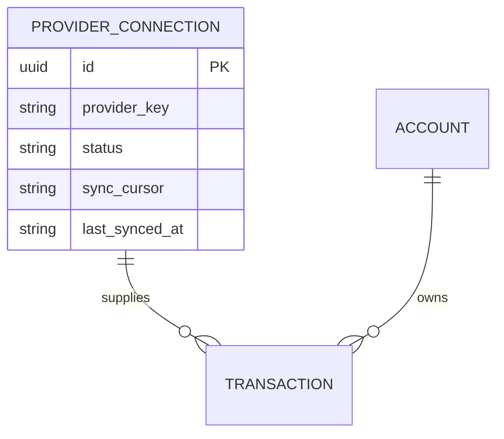
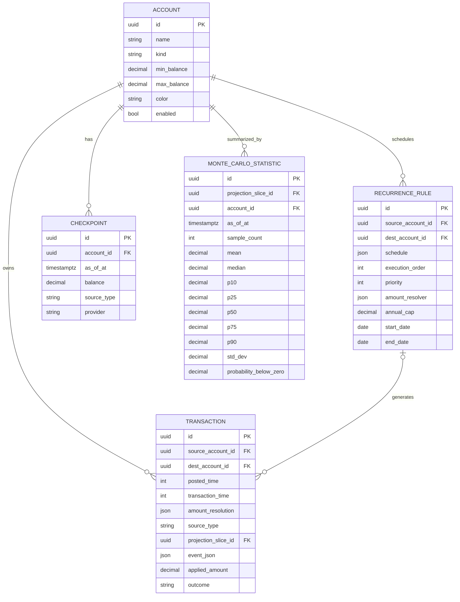
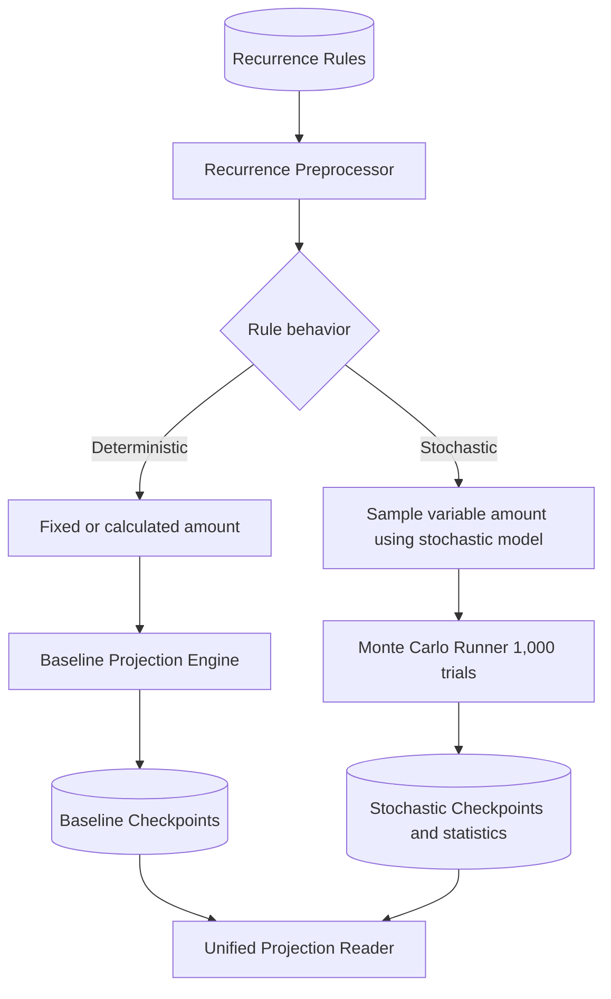
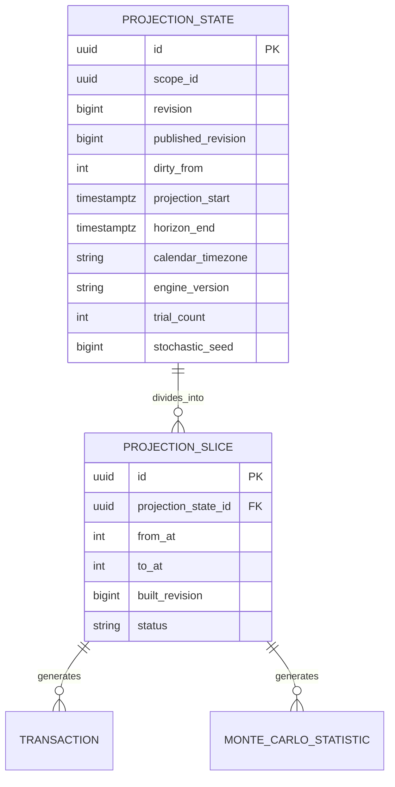

# Unified Projection Architecture

This document owns the target architecture. It maps the six diagram blocks to code. It lists defaults so implementation can proceed without further product input.

Rendered visuals live in `docs/diagrams/` (`.mmd` sources plus Pele-generated `.svg`):

- `architecture-overview` maps the six blocks end to end.
- `data-ingestion` is the provider plus transaction ERD.
- `unified-data-model` is the full domain ERD.
- `recurrence-workflow` is the rule classification flow.
- `incremental-slices` is the state plus slice plus output ERD.
- `slice-lifecycle` is the dirty, rebuild, and publish flow.
- `evaluation-plugins` is the reader plus simulator flow.
- `unified-read-api` is the ProjectionReader decision flow.

## Defaults (single owner for trial count, timezone, and engine version)

- Source enum is `user`, `banksync`, `projected`. Lowercase. Single spelling. `user` plus `banksync` are facts. `projected` is engine output. Provider identity lives in sync keys plus the checkpoint provider column, never in the source value.
- Trial count default is `1000`. The first stochastic build freezes the seed: an explicit request seed wins, otherwise a random seed draws once and persists. Repeat builds reuse it. This document owns the trial-count default; `TECHNICAL_OVERVIEW.md` points here and does not restate the default.
- Calendar timezone default is `UTC`. Engine version starts at `v1`. This document owns the timezone and engine-version defaults.
- One `default` projection state exists per user. Projection start freezes on first build from the requesting fallback date. Horizon end is start plus horizon years. Trial count and frozen seed are canonical: requests with different settings, run counts, or seeds bypass the stored rows and compute directly.
- Slices partition the canonical window into calendar years. Slice identity is stable: state plus start date.
- Revision increments on each dirty write. Built rows carry the revision they were built at. Slices are valid when their built revision equals the state revision. The dirty date scopes the rewrite: prefix slices adopt onto the new revision, suffix slices rebuild.
- Actual rows carry null `projection_slice_id`. Projected rows carry non null `projection_slice_id` plus the public event as JSON.
- Each evaluation persists in its own typed table per state and kind: net worth threshold, account balance, transaction fulfillment, cycle fulfillment, planned purchases, financial independence, and what-if. Scalar and date results are typed columns; variable-length evidence stays verbatim JSON so served bytes match computed output. Empty evaluation tables need no rows.
- Trial checkpoints never persist. Only baseline checkpoints plus per-date net worth statistics persist. History bands replay live; statistics cover projected dates only.
- Evaluation and pinned-evaluation writes do not dirty the projection. The reader serves their outputs from stored rows plus live tables. Account moves (position order only) skip dirty marking. New empty accounts skip dirty marking.
- Sync plans dirty from their earliest checkpoint or directive date inside the store, so direct `ApplySyncPlan` callers invalidate exactly like the ingest orchestrator.
- Every projection request computes the full window directly on a miss. Compute is full-window; persistence is suffix-only. A kernel resume that simulates only the suffix can land later without changing the read contract.
- Unseeded stochastic requests always compute fresh draws. Only seeded canonical requests use stored statistics.

## 1. Data Ingestion

Providers are SimpleFIN plus CSV plus Bank plus Manual Entry. Plaid plus MX stay out of scope. The store owns the single dirty mark in ApplySyncPlan; the ingest orchestrator inherits invalidation through it identically for every provider. The orchestrator owns fetch plus provision plus apply plus last-sync stamping. Each adapter translates its native feed to checkpoints plus bank directives. Manual Entry writes rows directly. Gmail receipt discovery stays as is and does not enter this path.

## 2. Unified Data Model

Notes:

- TRANSACTION uses source plus destination keys. One null means inflow or outflow. Both present means transfer.
- Source decides fact versus output. Lifecycle state decides pending versus void versus settled.
- CHECKPOINT rows are facts and SETS their balance. No generated checkpoints persist: timeline rows already carry projected balances, and position plus balances replay live history.
- MONTE_CARLO_STATISTIC stores portfolio net worth bands per date with an empty account id. Per-account bands arrive when the sampler tracks them. Percentile columns p25, p50, p75 complement p10, median, p90.
- Generated TRANSACTION rows live in transactions with source `projected` and the public event as JSON. Every model, sync, and analysis read filters them out by null slice. Row writes never set a slice.
- Evaluations, payment terms, planned purchases, and presets persist beside this diagram and enter the build as usual. Typed evaluation outputs persist per state and kind in one table per evaluation.

## 3. Shared Projection Pipeline

Recurrence Preprocessor owns schedule and sampling decisions: it expands rules into dated occurrences for the window and classifies each rule through the amount registry. Deterministic rules use fixed or calculated amounts. Stochastic rules use sampled variable amounts. The Baseline Projection Engine runs the deterministic path; both Monte Carlo paths run trials with the frozen seed. All paths write TRANSACTION rows with source `projected`. No generated checkpoints persist: timeline rows carry projected balances, and position plus balances replay live history. Unified Projection Reader serves all three.

Amount calculation and simulation are separate phases inside the engine. Prepare calculates one requested amount per occurrence from snapshots without touching runtime state. Apply resolves that request against constraints, applies the realized amount, and records the outcome. Impossible states (missing accounts, overdrafts, headroom and cap limits, investment losses, historical actuals) are handled entirely in Apply through the shared Resolve functions. The Monte Carlo Runner stays opt-in per rule and per run: a model with nothing volatile to sample simulates once and folds that path into every trial, bit-identical to N identical trials.

## 4. Incremental Slices with Single Date

Rules:

- Each write sets Unix `dirty_from` and bumps revision. Zero means clean. Creates use the new row's instant, checkpoints use their instant, sync plans use their earliest date. Updates, deletes, moves, conversions, claims, accounts, and payment terms dirty from projection start: no read precedes the mark, so an early date is never missed.
- Account moves (position order only), evaluation writes, pins, presets, links, and safe-spending settings do not dirty. New empty accounts and empty sync runs do not dirty either.
- Find first invalid slice means the first slice with `to_at` at or after `dirty_from`.
- Recompute suffix means delete suffix rows, rewrite the suffix manifest, persist the suffix, adopt the prefix, refresh evaluation outputs, and publish. Prefix inputs are identical by definition of the dirty date, so adoption is exact.
- Readers serve only when the state is clean, slices cover the window at the current revision, evaluation tables match the built tables, and stored outputs are current.
- Reads use `published_revision` only. Concurrent identical builds share one in-flight build per user.
- Databases created before this change need a fresh setup. There is no runtime migration and no legacy alias.

## 5. Evaluation Plugins

Evaluation Reader runs asynchronously through an independent evaluation worker (mirroring background analysis workers: durable discovery from `projection_states`, 60s leases, 30s failure backoff, superseded runs when inputs change). The worker is non-blocking and passive; reads never start work. Projection data is an optional input: readers that need a projection emit `projection-unavailable` and stay indeterminate when the path is missing, while projection-free evaluators run with the financial model alone. The shared result renderer keeps stored and computed responses bit-for-bit identical. Evaluation Simulator runs branch simulations on demand. What-if uses Isolated what-if inputs against a copy of the pipeline. What-if never mutates stored rows. Promote replays the set as row writes. Discard drops the copy.

## 6. Unified Read API

ProjectionReader serves deterministic reads from stored rows plus live history. It serves seeded canonical stochastic reads from stored statistics plus live history. Non-canonical requests (request model, overrides, as-of cut, different settings, run count, or seed) compute directly through the existing kernels. Position plus balances keep their live replay and never touch slices. Route shapes stay unchanged; the reader owns every projection response behind them.

`GET /v1/evaluations/status` is the passive execution-status read (`private, no-store`). It reports `idle|queued|running|failed|succeeded` with the current projection revision, published revision, dirty marker, fingerprint, and `projectionAvailable`; it never starts work.
