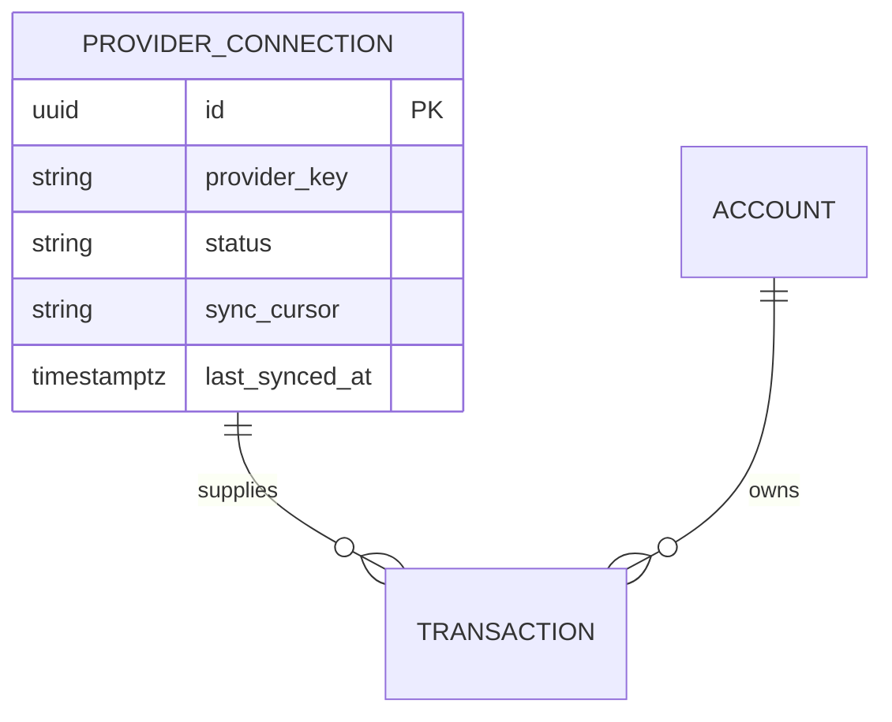
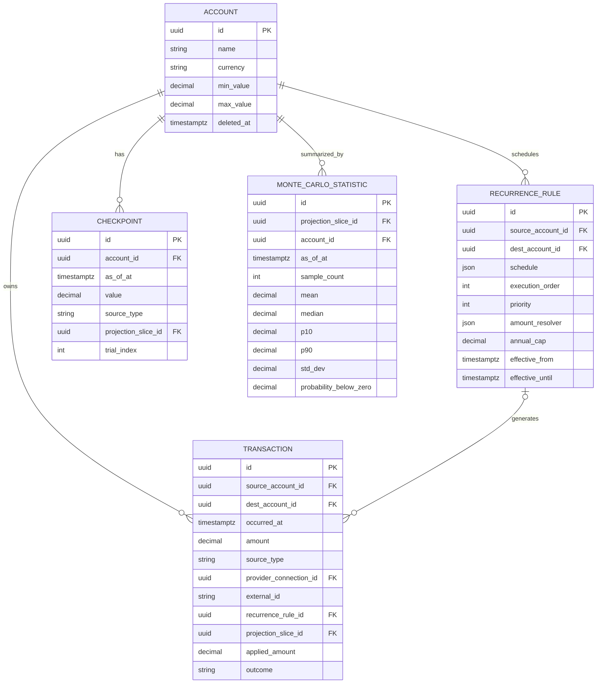
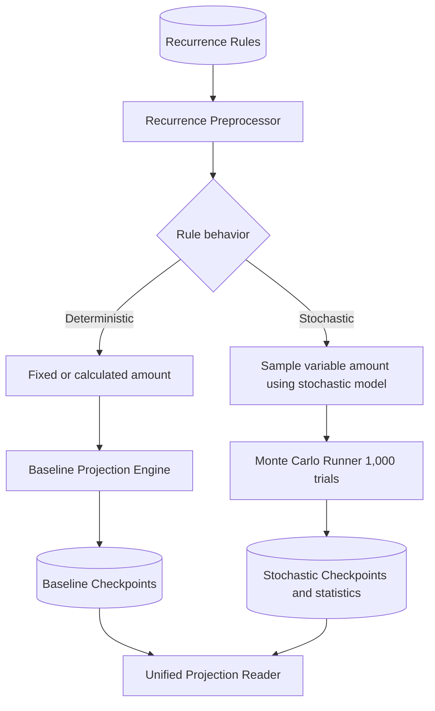
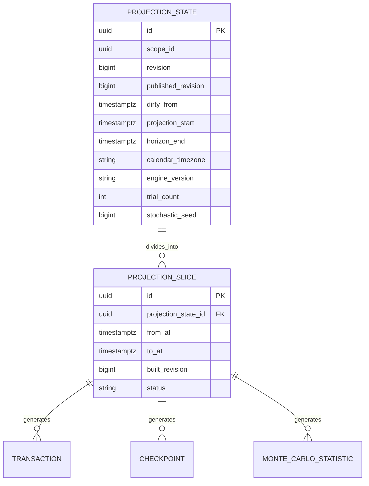

# Unified Projection Architecture

This document owns the target architecture. It maps the six diagram blocks to code. It lists defaults so implementation can proceed without further product input.

## Defaults

- Source enum is `user`, `banksync`, `projected`. Lowercase. Single spelling. `user` plus `banksync` are facts. `projected` is engine output. Stored rows predate this enum and use `simplefin` for bank facts. Readers treat `simplefin` as a bank fact until the one-time migration renames it. New writes use `banksync` only.
- Trial count default is `1000`. Seed default is null for a fresh state. Null means unseeded draws.
- Calendar timezone default is `UTC`. Engine version starts at `v1`.
- Horizon default is 30 years from projection start. Start defaults to the minimum of first CHECKPOINT and first TRANSACTION, then freezes in PROJECTION_STATE.
- Revision increments on each dirty write. Published revision advances only after suffix build succeeds. Readers use published rows only. One `default` projection state exists per user.
- Actual rows carry null `projection_slice_id`. Projected rows carry non null `projection_slice_id`.
- Trial index null means baseline. Non null means trial number.

## 1. Data Ingestion

Providers are SimpleFIN plus CSV plus Bank plus Manual Entry. Plaid plus MX stay out of scope. TransactionProvider Interface plus Adapters owns fetch plus map plus apply. Manual Entry writes directly. Gmail receipt discovery stays as is and does not enter this path.

## 2. Unified Data Model

Notes:

- TRANSACTION uses source plus destination keys. One null means inflow or outflow. Both present means transfer.
- Source decides fact versus output. Lifecycle state decides pending versus void versus settled.
- CHECKPOINT with null slice is a fact and SETS the balance. CHECKPOINT with non null slice is output.
- MONTE_CARLO_STATISTIC stores per account bands. Net worth bands derive from account bands plus evaluation output.

## 3. Shared Projection Pipeline

Recurrence Preprocessor classifies each rule. Deterministic rules use fixed or calculated amounts. Stochastic rules use sampled variable amounts. Baseline Projection Engine runs the deterministic path. Monte Carlo Runner runs 1000 trials by default. Both write CHECKPOINT rows plus TRANSACTION rows with source `projected`. Unified Projection Reader serves both.

## 4. Incremental Slices with Single Date

Rules:

- Each write sets `dirty_from` to the earliest affected instant.
- Data edits use the row date. Bound plus schedule plus resolver plus horizon plus engine version changes use projection start.
- Find first invalid slice means first slice with `to_at` at or after `dirty_from`.
- Recompute suffix means rebuild that slice and all later slices.
- Readers use `published_revision` only.

## 5. Evaluation Plugins

Evaluation Reader reads published slices without side effects. Evaluation Simulator runs Isolated what-if inputs against a copy of the pipeline. What-if never mutates stored rows. Promote replays the set as row writes. Discard drops the copy.

## 6. Unified Read API

ProjectionReader serves model plus balances plus position plus deterministic plus stochastic reads from published slices. It replaces separate projection reads. Row writes stay separate through Manual Entry and Adapter paths.
